# Phase 1 — Infrastructure Setup

**Project:** VortexDynamics – Enterprise Active Directory Infrastructure and IT Administration Lab  
**Virtualization platform:** VMware Workstation Pro 17  
**Virtual machines:** `VD-DC01` and `VD-CLIENT01`

---

## 1. Phase objective

The purpose of Phase 1 was to prepare the virtual infrastructure required for the VortexDynamics Active Directory lab. Two virtual machines were created in VMware Workstation:

- `VD-DC01` — Windows Server 2022 virtual machine, later configured as the domain controller.
- `VD-CLIENT01` — Windows 11 Pro virtual machine, later joined to the Active Directory domain.

This document covers virtual machine creation and the initial virtual hardware configuration shown in the supplied Word documents. Operating system installation, server configuration, DNS, domain joining and Active Directory configuration are documented in the later phases.

## 2. Lab infrastructure overview

| Component | VD-DC01 | VD-CLIENT01 |
|---|---|---|
| Purpose | Domain Controller | Domain-joined client |
| Guest operating system | Windows Server 2022 | Windows 11 x64 / Pro |
| Virtualization software | VMware Workstation Pro 17 | VMware Workstation Pro 17 |
| Memory | 4096 MB | 4096 MB |
| Processor | 2 processor cores | 2 processor cores |
| Virtual disk | 60 GB, split into multiple files | 64 GB, split into multiple files |
| Virtual disk controller | LSI Logic SAS | Not shown in supplied client screenshots |
| Network | Final lab: NAT / VMnet8 | NAT |
| VM name | `VD-DC01` | `VD-CLIENT01` |

**Final network design:** Both virtual machines are part of the VMware NAT network (VMnet8) in the completed lab. The initial VD-DC01 creation wizard screenshot shows **Host-only networking** selected at that point in the wizard. The server was subsequently configured to use the lab's NAT network. The VD-CLIENT01 wizard screenshot shows **NAT** selected.

---

# Part A — Create the Domain Controller Virtual Machine (VD-DC01)

## 3. Start the New Virtual Machine Wizard

1. Open **VMware Workstation Pro 17**.
2. From the VMware home screen, select **Create a New Virtual Machine**.
3. In the New Virtual Machine Wizard, select **Custom (advanced)**.
4. Click **Next**.

The Custom option provides access to the virtual hardware compatibility and device configuration options used while creating the server VM.

### Screenshot 01 — Select Custom (advanced) configuration

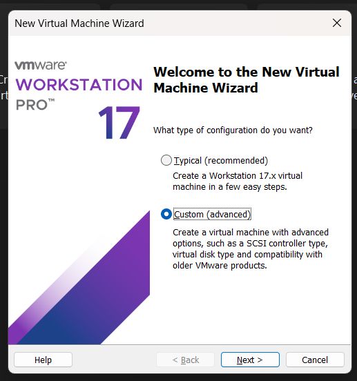

## 4. Select virtual machine hardware compatibility

1. On the **Choose the Virtual Machine Hardware Compatibility** screen, review the available compatibility level.
2. Keep **Workstation 17.x** selected, as shown in the source screenshot.
3. Click **Next**.

This determines the virtual hardware compatibility level for the VM.

### Screenshot 02 — Choose Workstation 17.x hardware compatibility

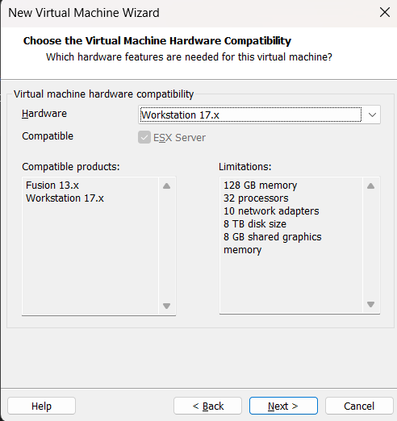

## 5. Choose the operating system installation method

1. On **Guest Operating System Installation**, select **I will install the operating system later**.
2. Click **Next**.

The VM is created with a blank virtual disk. The Windows Server 2022 operating system is installed separately in the server installation procedure documented in Phase 2.

### Screenshot 03 — Choose to install the guest operating system later

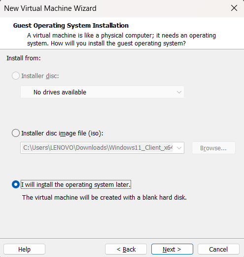

## 6. Specify the guest operating system

1. Under **Guest operating system**, select **Microsoft Windows**.
2. From the Version list, select **Windows Server 2022**.
3. Click **Next**.

### Screenshot 04 — Select Windows Server 2022

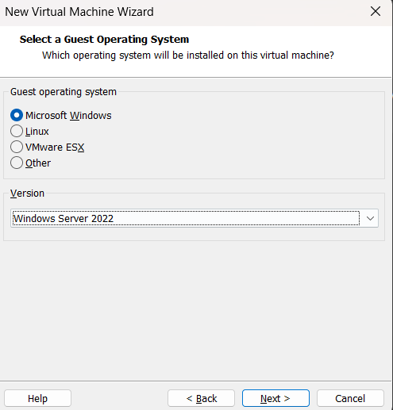

## 7. Name and locate the virtual machine

1. In **Name the Virtual Machine**, enter:

   `VD-DC01`

2. Set the virtual machine location to the project directory:

   `D:\VortexDynamics-AD-Lab\Virtual-Machines`

3. Confirm the name and location.
4. Click **Next**.

Keeping the virtual machines inside the project folder makes the lab files easier to organize and back up.

### Screenshot 05 — Name the virtual machine VD-DC01 and choose its location

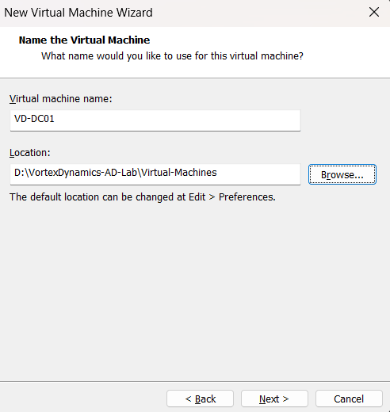

## 8. Configure firmware and processor

### 8.1 Firmware type

1. On **Firmware Type**, select **UEFI**.
2. Leave Secure Boot in the state shown in the source screenshot.
3. Click **Next**.

### Screenshot 06 — Select UEFI firmware

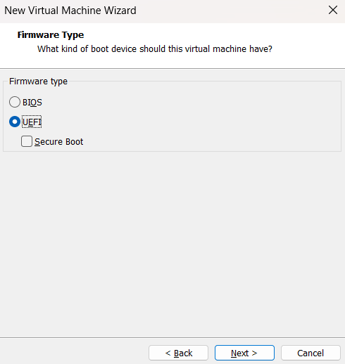

### 8.2 Processor configuration

1. On **Processor Configuration**, set the number of processors to `2`.
2. Set the number of cores per processor to `1`.
3. Confirm that the total number of processor cores is `2`.
4. Click **Next**.

### Screenshot 07 — Configure two processor cores

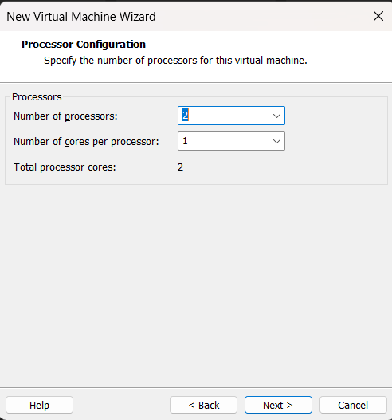

## 9. Configure memory and network type

### 9.1 Memory allocation

1. On **Memory for the Virtual Machine**, enter `4096 MB`.
2. Click **Next**.

The VM is allocated 4 GB of memory in the documented configuration.

### Screenshot 08 — Allocate 4096 MB of memory

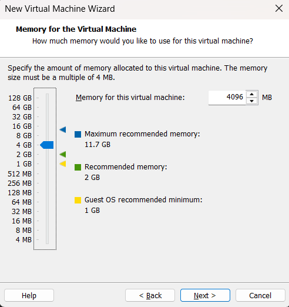

### 9.2 Network type shown during initial creation

1. On **Network Type**, review the available networking options.
2. The supplied screenshot shows **Use host-only networking** selected.
3. Click **Next** to continue through the wizard.

**Final lab configuration note:** The completed VortexDynamics environment uses VMware NAT networking (VMnet8) for both `VD-DC01` and `VD-CLIENT01`. The Host-only selection in this screenshot reflects the initial server VM wizard state, not the final network arrangement. The server was subsequently placed on the NAT network during lab setup.

### Screenshot 09 — Network type in the initial VD-DC01 wizard

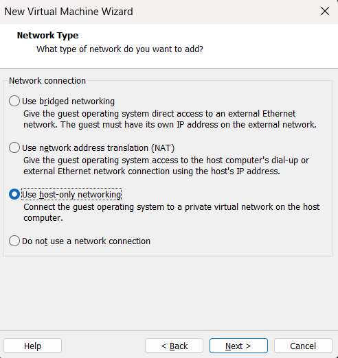

> The original image shows Host-only networking selected. The final lab uses NAT / VMnet8.

## 10. Configure the virtual disk controller and disk type

### 10.1 Select the I/O controller

1. On **Select I/O Controller Types**, select **LSI Logic SAS**.
2. Click **Next**.

### Screenshot 10 — Select the LSI Logic SAS controller

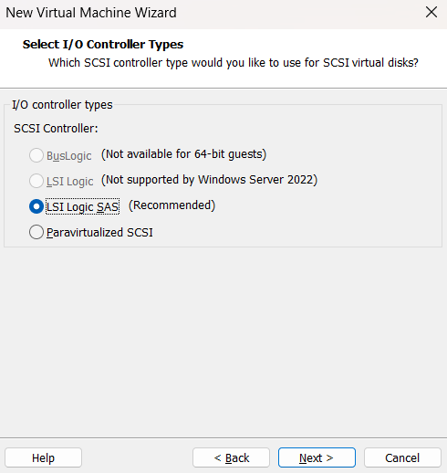

### 10.2 Select the virtual disk type

1. On **Select a Disk Type**, select **NVMe**.
2. Click **Next**.

### Screenshot 11 — Select NVMe virtual disk type

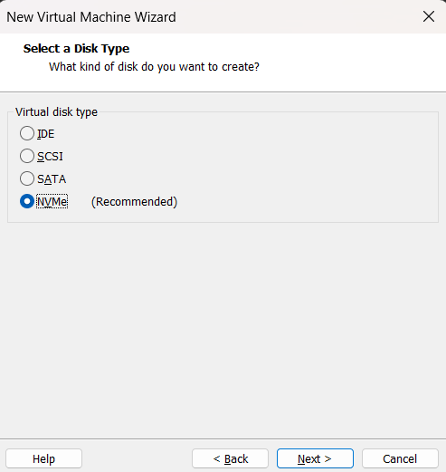

## 11. Create and configure the virtual disk

### 11.1 Create a new virtual disk

1. On **Select a Disk**, select **Create a new virtual disk**.
2. Click **Next**.

### Screenshot 12 — Create a new virtual disk

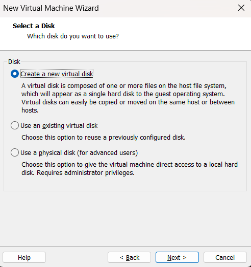

### 11.2 Specify disk capacity

1. On **Specify Disk Capacity**, enter `60 GB` as the maximum disk size.
2. Leave **Allocate all disk space now** unchecked.
3. Select **Split virtual disk into multiple files**.
4. Click **Next**.

Splitting the virtual disk stores it as multiple files, which can make it easier to move or copy the VM.

### Screenshot 13 — Set a 60 GB disk and split it into multiple files

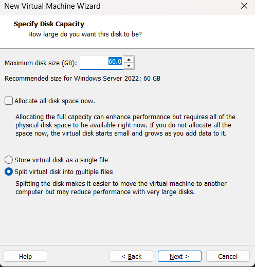

### 11.3 Specify the virtual disk filename

1. On **Specify Disk File**, review the virtual disk filename.
2. Keep the filename as `VD-DC01.vmdk`, as shown.
3. Click **Next**.

### Screenshot 14 — Specify VD-DC01.vmdk

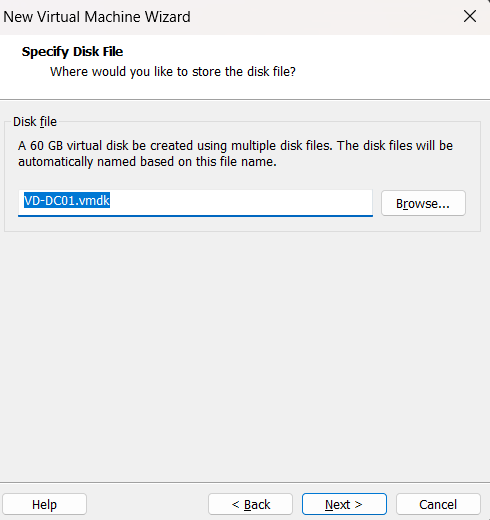

## 12. Review and create VD-DC01

1. On **Ready to Create Virtual Machine**, review the configuration.
2. Confirm the VM name is `VD-DC01`.
3. Confirm the guest operating system is Windows Server 2022.
4. Confirm the virtual disk is 60 GB and split.
5. Confirm the memory allocation is 4096 MB and the processor allocation is two cores.
6. Click **Finish** to create the VM.

### Screenshot 15 — Review the VD-DC01 virtual machine configuration

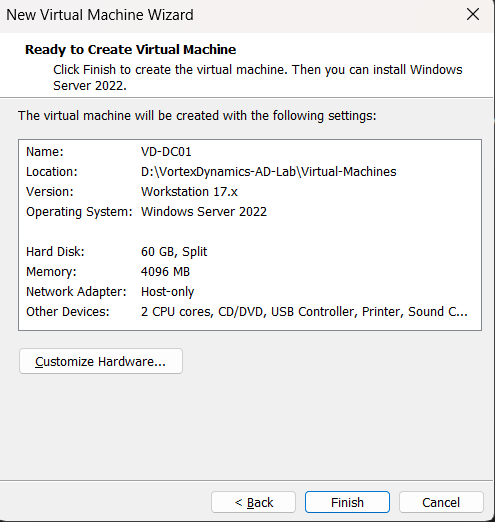

## 13. Verify VD-DC01 appears in VMware Workstation

1. After the wizard closes, locate `VD-DC01` in the VMware library.
2. Select the VM and review its virtual hardware summary.
3. Confirm that the VM has been created successfully.
4. The Windows Server operating system installation is performed in Phase 2.

### Screenshot 16 — VD-DC01 created in VMware Workstation

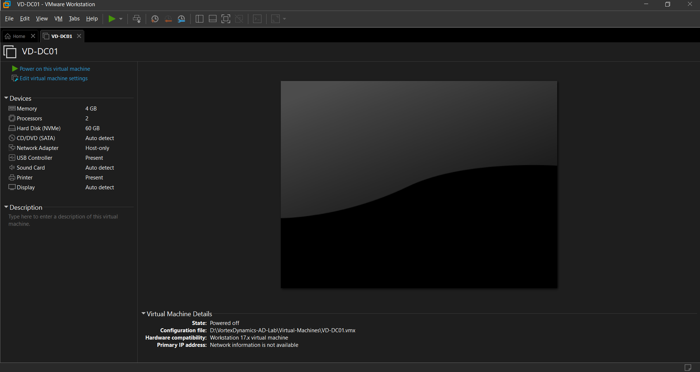

---

# Part B — Create the Windows 11 Client Virtual Machine (VD-CLIENT01)

## 14. Start the New Virtual Machine Wizard

1. In VMware Workstation Pro 17, select **Create a New Virtual Machine**.
2. On the welcome screen, select **Typical (recommended)**.
3. Click **Next**.

The Typical option guides the user through the basic VM configuration.

### Screenshot 17 — Select Typical (recommended) configuration

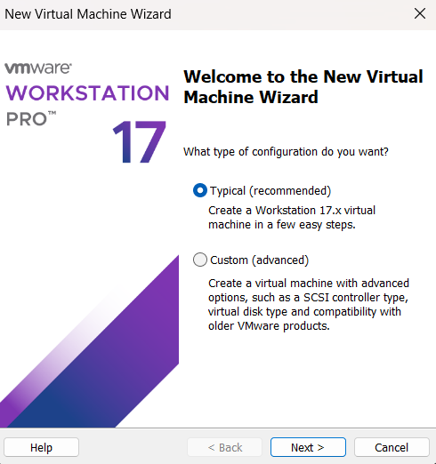

## 15. Choose the operating system installation method

1. On **Guest Operating System Installation**, select **I will install the operating system later**.
2. Click **Next**.

The Windows 11 installation is performed after the virtual machine has been created.

### Screenshot 18 — Choose to install the guest operating system later

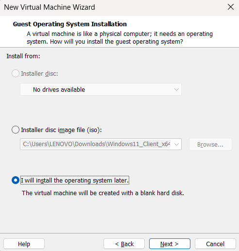

## 16. Specify the guest operating system

1. Under **Guest operating system**, select **Microsoft Windows**.
2. From the Version list, select **Windows 11 x64**.
3. Click **Next**.

### Screenshot 19 — Select Windows 11 x64

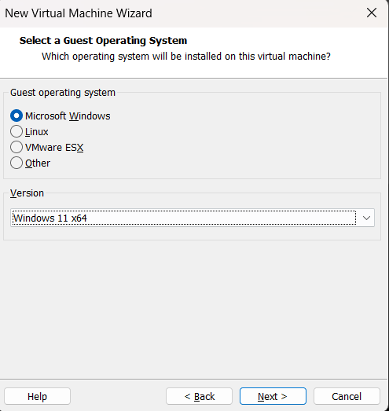

## 17. Name and locate the client virtual machine

1. In **Name the Virtual Machine**, enter:

   `VD-CLIENT01`

2. Review the storage location shown in the wizard.
3. Confirm the virtual machine name.
4. Click **Next**.

### Screenshot 20 — Name the client virtual machine VD-CLIENT01

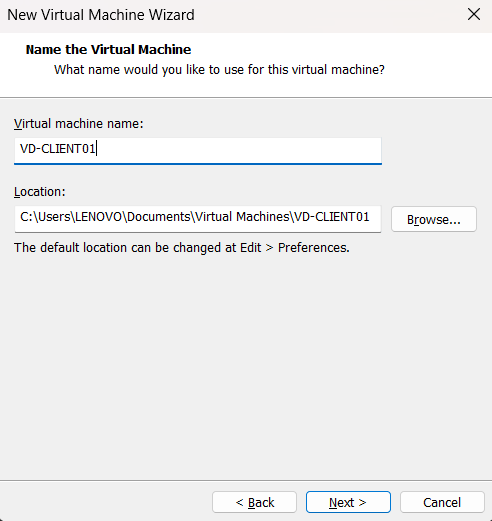

## 18. Configure virtual machine encryption and TPM support

The Windows 11 VM wizard displays an encryption information screen because Windows 11 requires a Trusted Platform Module (TPM).

1. Review the encryption options.
2. The source screenshot shows **Only the files needed to support a TPM are encrypted** selected.
3. Enter and confirm the encryption password.
4. The screenshot shows **Remember the password on this machine in Credential Manager** selected.
5. Store the password securely because it may be required to access the encrypted VM files.
6. Click **Next**.

Do not include the actual password in project documentation or screenshots.

### Screenshot 21 — Configure encryption for TPM support

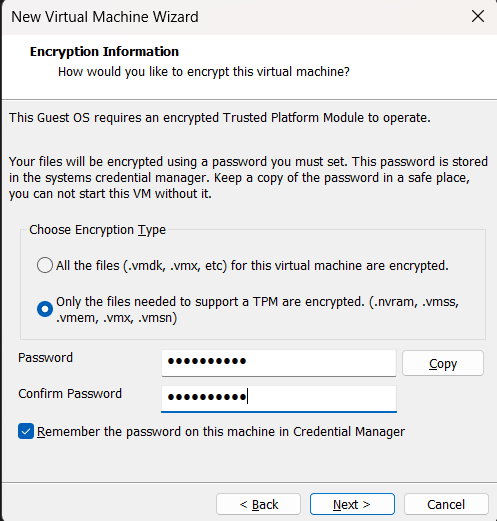

## 19. Configure the client virtual disk

1. On **Specify Disk Capacity**, enter `64 GB` as the maximum disk size.
2. Select **Split virtual disk into multiple files**.
3. Click **Next**.

The wizard indicates 64 GB as the recommended size for Windows 11 x64 in the captured configuration.

### Screenshot 22 — Set a 64 GB split virtual disk

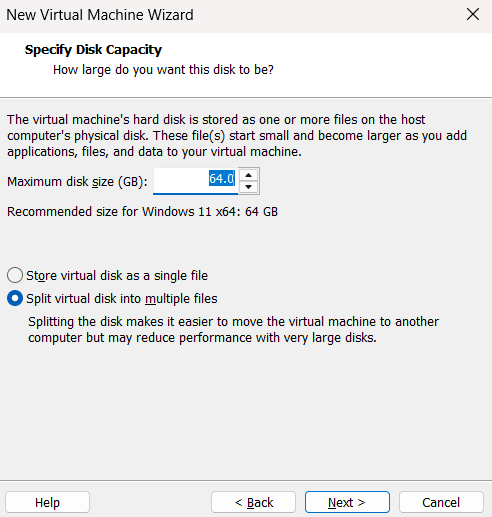

## 20. Review and create VD-CLIENT01

1. On **Ready to Create Virtual Machine**, review the client VM configuration.
2. Confirm the VM name is `VD-CLIENT01`.
3. Confirm the guest operating system is Windows 11 x64.
4. Confirm the disk size is 64 GB and split into multiple files.
5. Confirm the memory is 4096 MB.
6. Confirm the processor allocation is two cores.
7. Confirm the network adapter is set to NAT.
8. Click **Finish**.

### Screenshot 23 — Review and create VD-CLIENT01

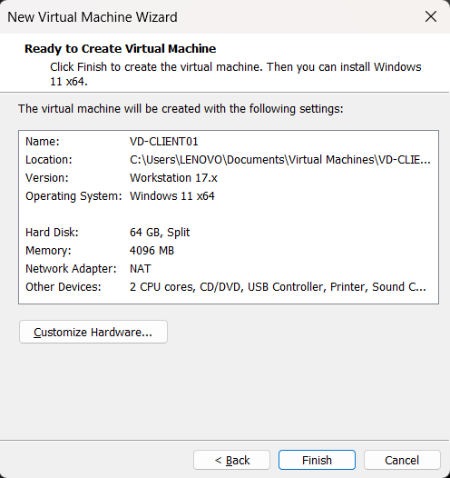

## 21. Verify VD-CLIENT01 appears in VMware Workstation

1. After the wizard closes, locate `VD-CLIENT01` in the VMware library.
2. Select the VM.
3. Review the VM summary and confirm it has been created.
4. The Windows 11 operating system installation and client configuration are documented in Phase 2.

### Screenshot 24 — VD-CLIENT01 created in VMware Workstation

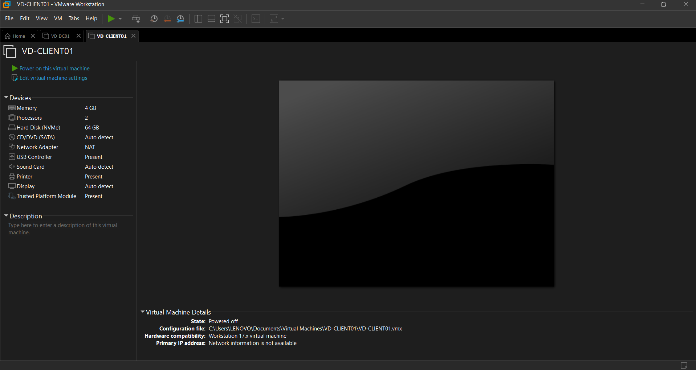

---

## 22. Phase 1 completion summary

The following infrastructure preparation tasks are documented in this phase:

- Created the `VD-DC01` virtual machine in VMware Workstation Pro 17.
- Selected Windows Server 2022 as the guest operating system.
- Configured the server VM with 4096 MB RAM and two processor cores.
- Created a 60 GB split virtual disk for `VD-DC01`.
- Selected UEFI firmware, LSI Logic SAS controller and NVMe disk type for the server VM.
- Created the `VD-CLIENT01` virtual machine.
- Selected Windows 11 x64 as the client guest operating system.
- Configured the client VM with 4096 MB RAM and two processor cores.
- Created a 64 GB split virtual disk for `VD-CLIENT01`.
- Configured the client VM network adapter to NAT.
- Prepared both VMs for operating system installation and subsequent lab configuration.

## 23. Relationship to the next phases

- **Phase 2 — Active Directory Configuration:** Windows Server and Windows 11 installation, server network setup, AD DS and DNS configuration, client network configuration, domain joining, and Active Directory users, groups and computers.
- **Phase 3 — Group Policy Management:** Password policy, USB removable-disk restrictions, Control Panel restriction, GPO linking and policy verification.
