# VortexDynamics — Client Configuration, Domain Join and Active Directory Objects

**Project:** VortexDynamics – Enterprise Active Directory Infrastructure and IT Administration Lab  
**Phase:** Phase 2 — Active Directory Configuration (Client-side and directory objects)  
**Domain:** `vortexdynamics.test`  
**Domain Controller:** `VD-DC01`  
**Client computer:** `VD-CLIENT01`

---

## 1. Objective

This document records the client-side and Active Directory tasks shown in the supplied Word document:

1. Configure the Windows 11 client network adapter with a static IPv4 address.
2. Verify connectivity between the client and domain controller.
3. Join `VD-CLIENT01` to `vortexdynamics.test`.
4. Open Active Directory Users and Computers (ADUC).
5. Create the VortexDynamics departmental OU structure.
6. Create departmental user accounts.
7. Create departmental security groups and add users to the appropriate groups.
8. Move the client computer account into the IT Computers OU.

The screenshots are embedded in the order they appear in the source Word document.

## 2. Lab configuration

| Component | Configuration |
|---|---|
| Client computer | `VD-CLIENT01` |
| Operating system | Windows 11 Pro |
| IPv4 address | `192.168.176.20` |
| Subnet mask | `255.255.255.0` |
| Default gateway | `192.168.176.2` |
| Preferred DNS | `192.168.176.10` |
| Alternate DNS | Blank in the final lab configuration |
| Domain | `vortexdynamics.test` |
| Domain controller | `VD-DC01` (`192.168.176.10`) |
| VMware network | NAT / VMnet8 |

**DNS configuration note:** The network-settings screenshot in the supplied Word document visibly shows `8.8.8.8` as Alternate DNS. The final configuration agreed for this lab is Preferred DNS `192.168.176.10` and Alternate DNS left blank. The external resolver `8.8.8.8` is configured as a forwarder on `VD-DC01` in DNS Manager, not as the client's alternate DNS server.

---

## 3. Configure the Windows client network settings

### 3.1 Open Network Connections

1. Sign in to the Windows 11 client.
2. Press `Win + R` to open the Run dialog.
3. Type `ncpa.cpl` and press **Enter**.
4. In Network Connections, right-click the active Ethernet adapter.
5. Select **Properties**.
6. Select **Internet Protocol Version 4 (TCP/IPv4)**.
7. Click **Properties**.


### Screenshot 01 — Open Network Connections using ncpa.cpl

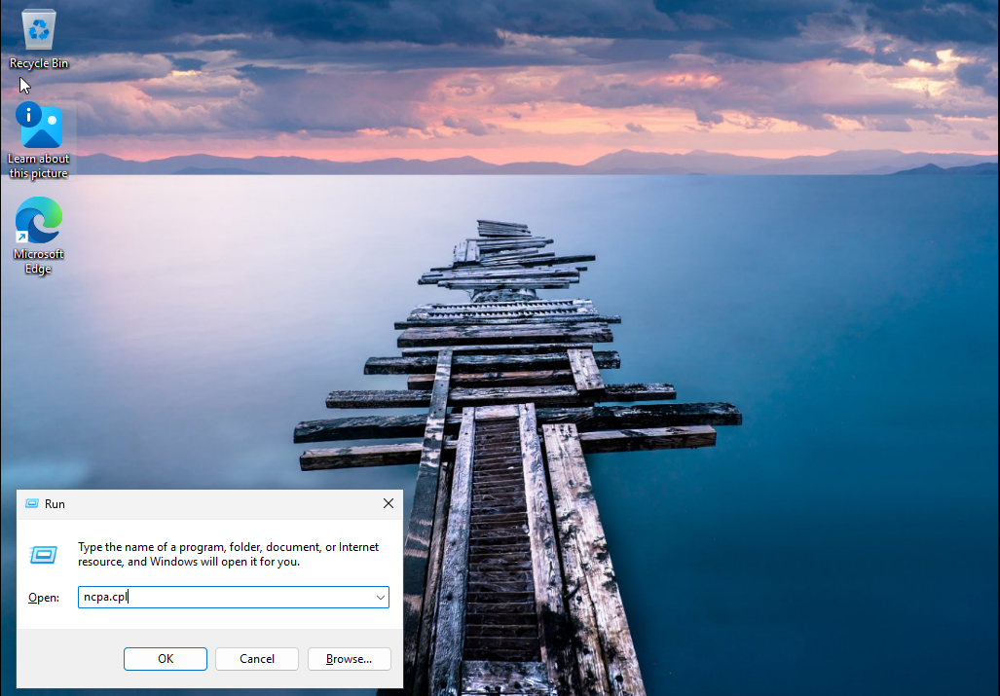


### 3.2 Configure the static IPv4 address

1. Select **Use the following IP address**.
2. Enter:
   - IP address: `192.168.176.20`
   - Subnet mask: `255.255.255.0`
   - Default gateway: `192.168.176.2`
3. Select **Use the following DNS server addresses**.
4. Set Preferred DNS server to `192.168.176.10` (the IP address of `VD-DC01`).
5. Leave Alternate DNS server blank in the final lab configuration.
6. Click **OK**, then **Close**.

The client must use the domain controller's DNS service so it can locate Active Directory domain services and resolve domain records.


### Screenshot 02 — Set the client's static IPv4 and DNS settings

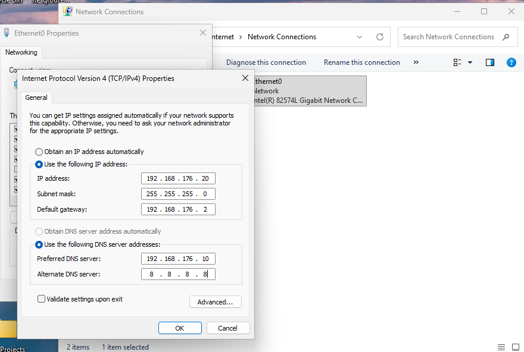


### 3.3 Verify the client network configuration

1. Open Command Prompt.
2. Run:

```cmd
ipconfig /all
```

3. Review the active Ethernet adapter.
4. Confirm the client IPv4 address is `192.168.176.20`.
5. Confirm the subnet mask is `255.255.255.0`.
6. Confirm the default gateway is `192.168.176.2`.
7. Confirm the DNS server is `192.168.176.10`.


### Screenshot 03 — Verify client network settings and connectivity

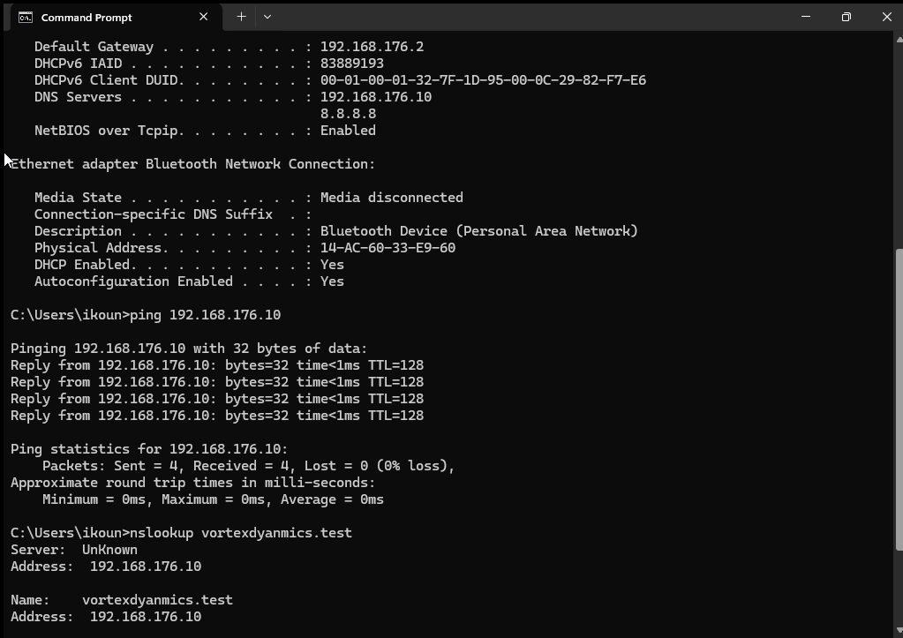


### 3.4 Test connectivity and DNS resolution

Run:

```cmd
ping 192.168.176.10
nslookup vortexdynamics.test
```

Confirm that the ping receives replies from the domain controller and that the DNS query resolves `vortexdynamics.test` to `192.168.176.10`.

The screenshot shows successful replies from `192.168.176.10` and a DNS answer for `vortexdynamics.test` pointing to the domain controller.

---

## 4. Join VD-CLIENT01 to the Active Directory domain

### 4.1 Open System Properties

1. On the client, press `Win + R`.
2. Type `sysdm.cpl`.
3. Press **Enter**.
4. In System Properties, open the **Computer Name** tab.
5. Click **Change**.


### Screenshot 04 — Open System Properties using sysdm.cpl

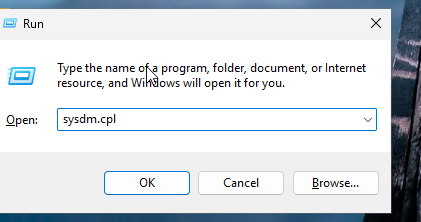


### 4.2 Enter the domain name

1. In **Computer Name/Domain Changes**, confirm the computer name is `VD-CLIENT01`.
2. Under **Member of**, select **Domain**.
3. Enter `vortexdynamics.test`.
4. Click **OK**.


### Screenshot 05 — Enter vortexdynamics.test as the client's domain

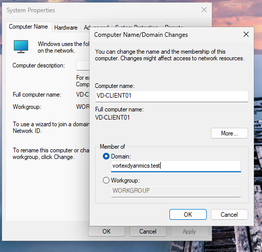


### 4.3 Provide domain credentials

1. When the Windows Security prompt appears, enter an account authorized to join computers to the domain.
2. The screenshot shows the username `Administrator`.
3. Enter the domain Administrator password.
4. Click **OK** and wait for Windows to validate the credentials with the domain controller.


### Screenshot 06 — Enter domain credentials to authorize the domain join

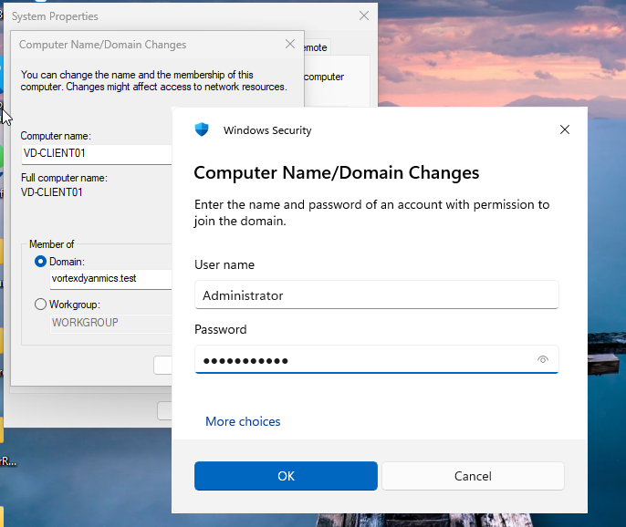


### 4.4 Confirm successful domain joining

1. Windows should display a welcome message for the `vortexdynamics.test` domain.
2. Click **OK**.
3. Close the remaining System Properties dialogs.
4. Restart the client when prompted. Restarting completes the domain membership change.
5. After restart, `VD-CLIENT01` is a member of `vortexdynamics.test`.


### Screenshot 07 — Windows confirms that the client joined vortexdynamics.test

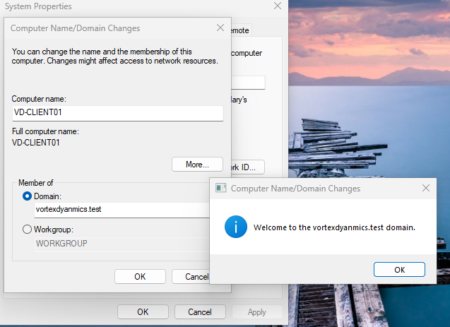


### 4.5 Check the current account context

The supplied document includes a Command Prompt screenshot showing the `whoami` command.

```cmd
whoami
```

The screenshot displays `vd-client01\ikoun`. This identifies the account context at the time the screenshot was captured. The domain welcome message in the previous step is the direct evidence of successful domain joining.


### Screenshot 08 — Check the current account context with whoami

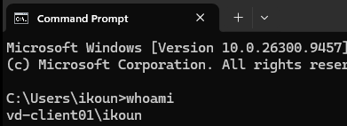


---

## 5. Open Active Directory Users and Computers

The directory configuration is performed on `VD-DC01` using an account with appropriate Active Directory permissions.

1. Sign in to `VD-DC01`.
2. Open **Server Manager**.
3. Select **Tools → Active Directory Users and Computers**.
4. In the left pane, expand `vortexdynamics.test`.
5. Review the default containers, including Users, Computers and Domain Controllers.


### Screenshot 09 — Open Active Directory Users and Computers from Server Manager

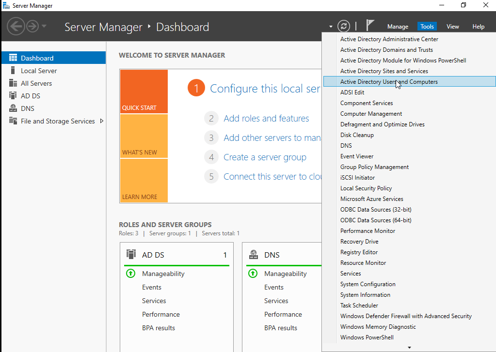


### Screenshot 10 — Inspect the domain in Active Directory Users and Computers

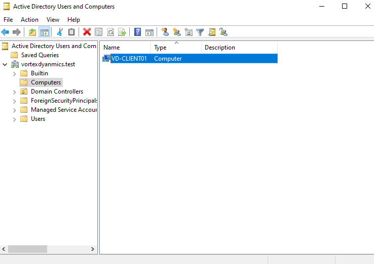


---

## 6. Create the VortexDynamics Organizational Unit structure

### 6.1 Create the top-level OUs

1. In Active Directory Users and Computers, right-click `vortexdynamics.test`.
2. Select **New → Organizational Unit**.
3. Create these top-level OUs:
   - `VortexDynamics Users`
   - `VortexDynamics Computers`
   - `VortexDynamics Groups`
4. Keep **Protect container from accidental deletion** selected.
5. Click **OK** for each OU.


### Screenshot 11 — Create the VortexDynamics Users organizational unit

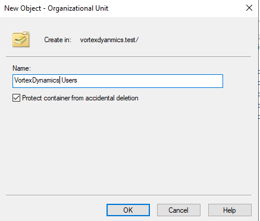


### 6.2 Create departmental child OUs

Create these child OUs under the corresponding parent OU.

**Under `VortexDynamics Users`:**
- `HR`
- `IT`
- `Finance`
- `Sales`
- `Management`

**Under `VortexDynamics Computers`:**
- `HR Computers`
- `IT Computers`
- `Finance Computers`
- `Sales Computers`
- `Management Computers`

**Under `VortexDynamics Groups`:**
- `HR Groups`
- `IT Groups`
- `Finance Groups`
- `Sales Groups`
- `Management Groups`

For each child OU:

1. Right-click its parent OU.
2. Select **New → Organizational Unit**.
3. Enter the child OU name.
4. Keep **Protect container from accidental deletion** selected.
5. Click **OK**.
6. Repeat until the department OUs have been created.


### Screenshot 12 — Verify the completed VortexDynamics OU hierarchy

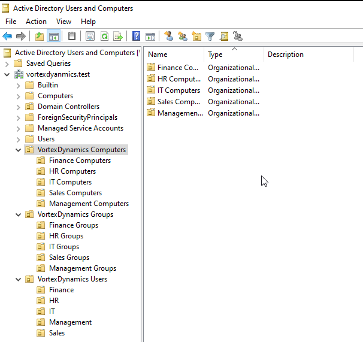


---

## 7. Create departmental Active Directory user accounts

### 7.1 Open the target department OU

1. Expand `VortexDynamics Users`.
2. Select the department OU for the new account. The source document demonstrates the HR OU.
3. Right-click the OU.
4. Select **New → User**.

### 7.2 Enter the user details

The example shown in the screenshots is:

| Field | Value |
|---|---|
| First name | Rahul |
| Last name | Sharma |
| Full name | Rahul Sharma |
| User logon name | `rahul.sharma` |
| Pre-Windows 2000 logon name | `VORTEXDYNAMICS\rahul.sharma` |

1. Enter the first name and last name.
2. Confirm the full name.
3. Enter the user logon name.
4. Click **Next**.


### Screenshot 13 — Enter Rahul Sharma's Active Directory user details

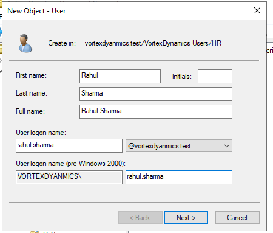


### 7.3 Set a temporary password

1. Enter a temporary password.
2. Re-enter it in **Confirm password**.
3. Keep **User must change password at next logon** selected.
4. Leave the other account options unchecked unless a specific requirement applies.
5. Click **Next**.


### Screenshot 14 — Set the user's temporary password and require a change at next logon

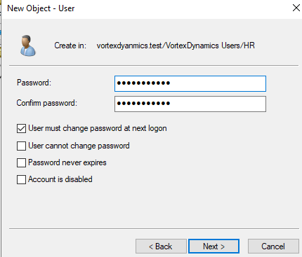


### 7.4 Review and create the account

1. Review the account summary.
2. Confirm the full name and user logon name.
3. Confirm that the user must change the password at the next logon.
4. Click **Finish**.


### Screenshot 15 — Review the new user account and click Finish

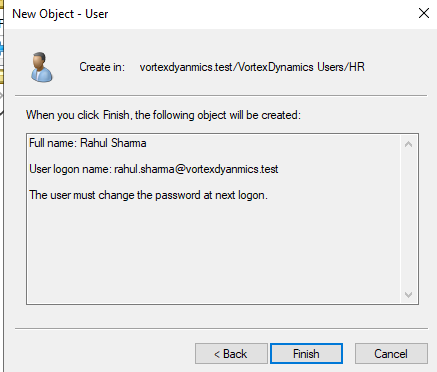


### 7.5 Departmental user accounts created in the lab

The VortexDynamics lab directory includes these accounts:

| Departmental OU | Display name | User logon name |
|---|---|---|
| HR | Rahul Sharma | `rahul.sharma` |
| IT | Amit Patil | `amit.patil` |
| Finance | Priya Singh | `priya.singh` |
| Sales | Neha Verma | `neha.verma` |
| IT | Admin User | `admin.it` |
| Management | Vikram Mehta | `vikram.mehta` |

Repeat the New User wizard for each account. Place each account in the matching departmental OU and assign a temporary password.

---

## 8. Create departmental security groups

### 8.1 Create a Global Security group

1. Expand `VortexDynamics Groups`.
2. Open the department's group OU. The example shown is `HR Groups`.
3. Right-click the OU and select **New → Group**.
4. Enter the group name `GG_HR`.
5. Under **Group scope**, select **Global**.
6. Under **Group type**, select **Security**.
7. Click **OK**.


### Screenshot 16 — Create GG_HR as a Global Security group

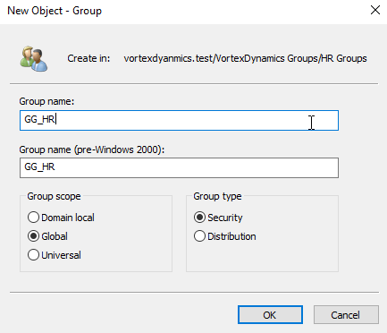


### 8.2 Create the remaining departmental groups

Repeat the same procedure in the corresponding OU:

| Group OU | Group name | Scope | Type |
|---|---|---|---|
| HR Groups | `GG_HR` | Global | Security |
| IT Groups | `GG_IT` | Global | Security |
| Finance Groups | `GG_Finance` | Global | Security |
| Sales Groups | `GG_Sales` | Global | Security |
| Management Groups | `GG_Management` | Global | Security |

For each group:

1. Right-click the corresponding departmental group OU.
2. Select **New → Group**.
3. Enter the group name.
4. Select **Global** scope and **Security** group type.
5. Click **OK**.


### Screenshot 17 — Verify the departmental group in its OU

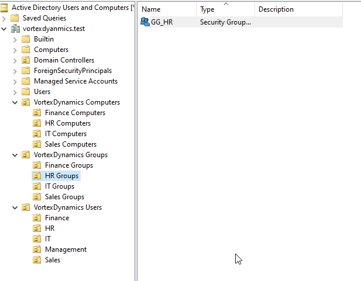


---

## 9. Add users to their departmental security groups

### 9.1 Open the group's Members tab

1. In Active Directory Users and Computers, open the relevant departmental group OU.
2. Right-click the group, for example `GG_HR`.
3. Select **Properties**.
4. Open the **Members** tab.
5. Click **Add**.


### Screenshot 18 — Open the Members tab and select Add

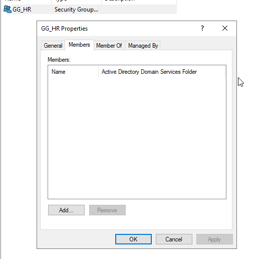


### 9.2 Search for the user

1. In the object selection dialog, enter the user's name.
2. For the HR example, enter `Rahul Sharma`.
3. Click **Check Names** to validate the account.
4. Click **OK**.


### Screenshot 19 — Search for Rahul Sharma and validate the account

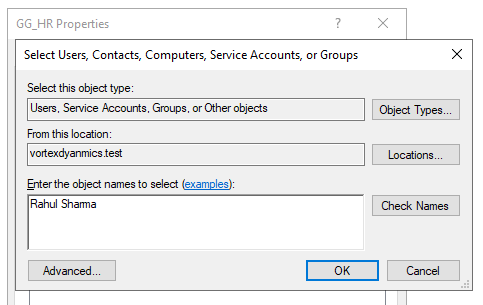


### 9.3 Confirm group membership

1. Return to the group's **Members** tab.
2. Confirm the selected user appears in the member list.
3. Click **Apply**, then **OK**.


### Screenshot 20 — Verify Rahul Sharma is a member of GG_HR

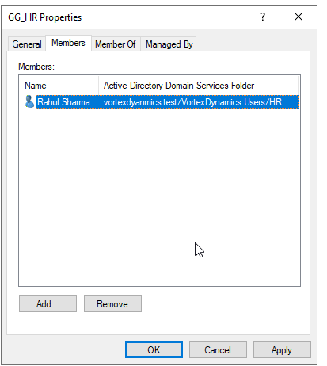


### 9.4 Departmental group membership

Add the corresponding users to their departmental Global Security groups:

| Security group | User members |
|---|---|
| `GG_HR` | Rahul Sharma |
| `GG_IT` | Amit Patil, Admin User |
| `GG_Finance` | Priya Singh |
| `GG_Sales` | Neha Verma |
| `GG_Management` | Vikram Mehta |

Repeat **Members → Add → Check Names** for each group and its corresponding users.

---

## 10. Move VD-CLIENT01 into the IT Computers OU

### 10.1 Move the computer account

1. In Active Directory Users and Computers, expand the default **Computers** container.
2. Locate `VD-CLIENT01`.
3. Right-click the computer account and select **Move**.
4. In the destination tree, expand `VortexDynamics Computers`.
5. Select `IT Computers`.
6. Click **OK**.


### Screenshot 21 — Select IT Computers as the destination OU for VD-CLIENT01

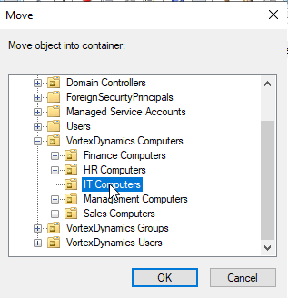


### 10.2 Verify the computer account location

1. Expand `VortexDynamics Computers`.
2. Select `IT Computers`.
3. Confirm that `VD-CLIENT01` appears in the right pane.


### Screenshot 22 — Verify VD-CLIENT01 is located in the IT Computers OU

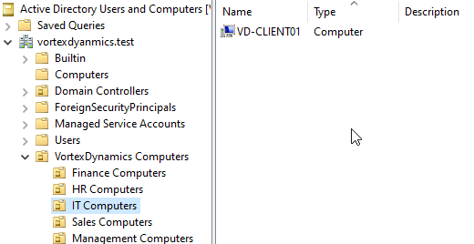


---