# VortexDynamics — Windows Server 2022, AD DS and DNS Configuration

**Project:** VortexDynamics – Enterprise Active Directory Infrastructure and IT Administration Lab  
**Document scope:** Server-side setup only  
**Server:** `VD-DC01`  
**Domain:** `vortexdynamics.test`  
**NetBIOS name:** `VORTEXDYNAMICS`

---

## 1. Objective

This document records the server-side implementation in the sequence shown in the supplied Word document:

1. Install Windows Server 2022 Standard Evaluation (Desktop Experience).
2. Configure the local Administrator account and server name.
3. Configure static IPv4 networking and verify connectivity.
4. Install Active Directory Domain Services (AD DS) and DNS Server roles.
5. Promote the server to the first domain controller in `vortexdynamics.test`.
6. Verify domain controller services and shares.
7. Inspect DNS, configure a forwarder and test name resolution.

**Scope:** This document covers only the server-side work. Windows 11 client setup and domain joining will be documented separately after the client screenshots are supplied.

## 2. Lab configuration

| Setting | Value |
|---|---|
| Operating system | Windows Server 2022 Standard Evaluation (Desktop Experience) |
| Server name | `VD-DC01` |
| IPv4 address | `192.168.176.10` |
| Subnet mask | `255.255.255.0` |
| Default gateway | `192.168.176.2` |
| Preferred DNS | `192.168.176.10` |
| Alternate DNS | Blank in final lab configuration |
| AD DS forest/domain | `vortexdynamics.test` |
| NetBIOS name | `VORTEXDYNAMICS` |
| DNS forwarder | `8.8.8.8` |

The lab uses VMware NAT networking. The server uses its own DNS service as the preferred DNS server. External DNS requests are forwarded by DNS Manager.

---

## 3. Install Windows Server 2022

### 3.1 Start Windows Setup

1. Create and start the `VD-DC01` virtual machine in VMware Workstation.
2. Attach the Windows Server 2022 ISO to the virtual CD/DVD drive.
3. Power on the VM and boot from the ISO.
4. At the language and regional settings screen, review the displayed options.
5. Click **Next**, then click **Install now**.


### Screenshot 01 — Windows Setup language and regional settings

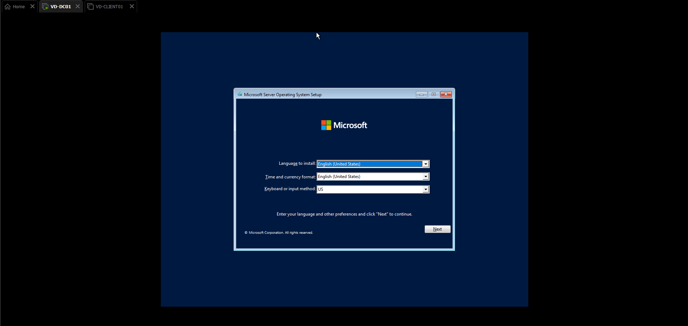


### Screenshot 02 — Windows Server Setup — Install now

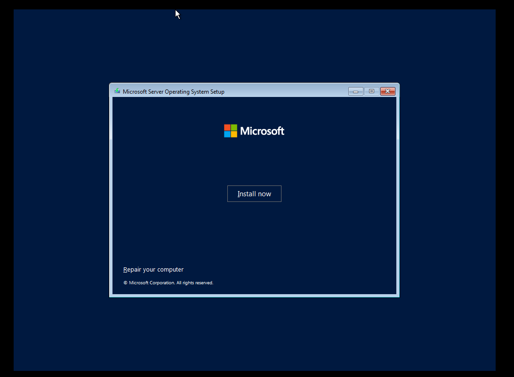

### 3.2 Select the Windows Server edition

1. Select **Windows Server 2022 Standard Evaluation (Desktop Experience)**.
2. Confirm that the Desktop Experience option is selected because the lab uses the graphical interface.
3. Click **Next**.


### Screenshot 03 — Select Windows Server 2022 Standard Evaluation (Desktop Experience)

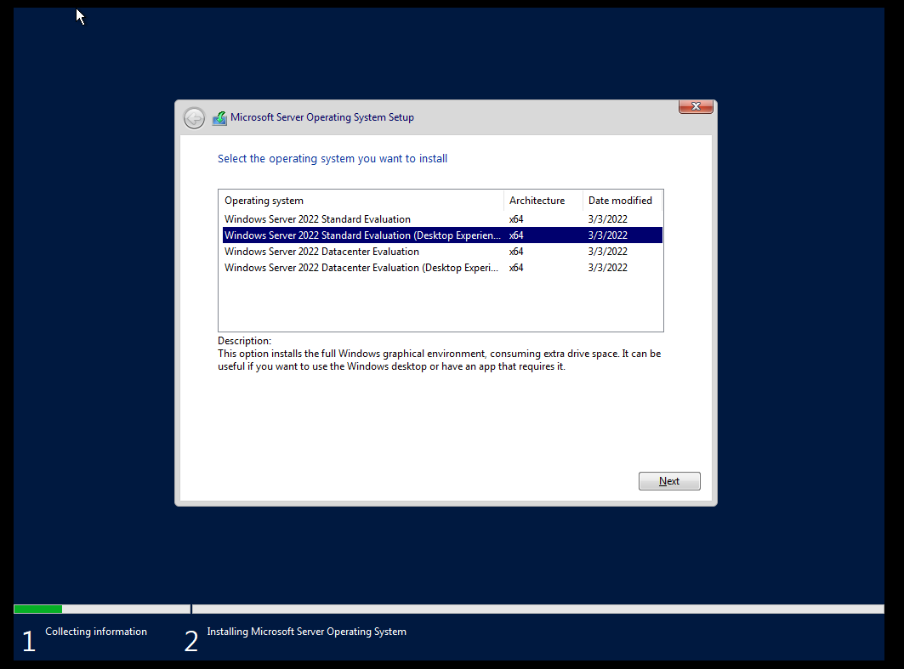

### 3.3 Accept the license terms

1. Review the Microsoft software license terms.
2. Select **I accept the Microsoft Software License Terms**.
3. Click **Next**.


### Screenshot 04 — Accept the Microsoft software license terms

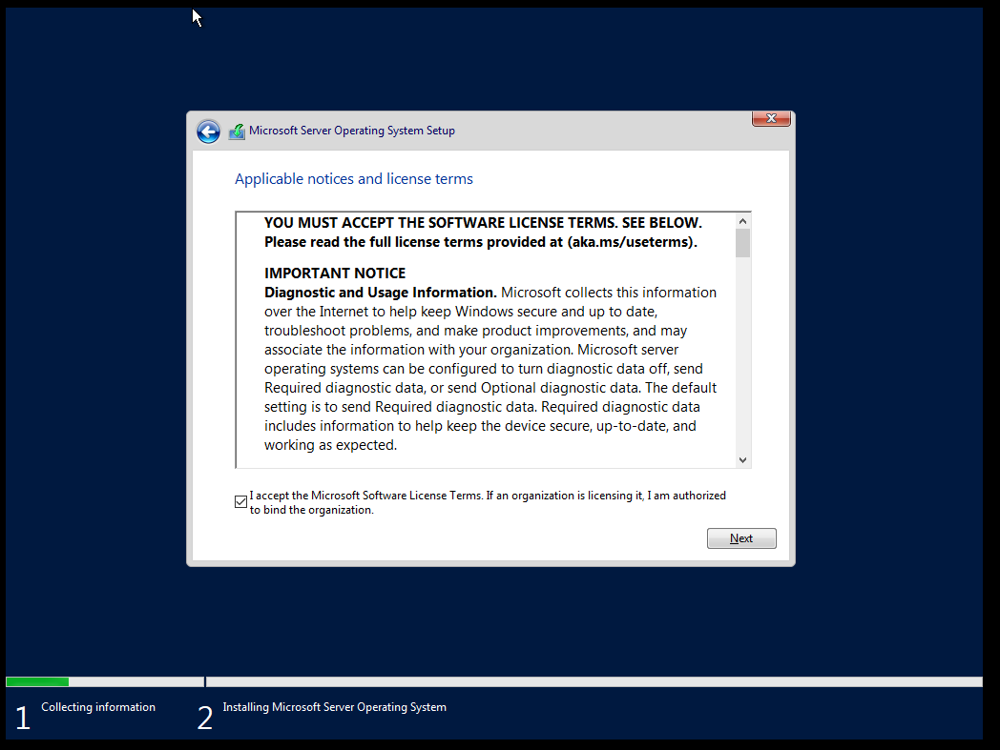

### 3.4 Choose installation type and destination disk

1. Select **Custom: Install Microsoft Server Operating System only (advanced)**.
2. On the disk selection screen, select the available unallocated virtual disk.
3. Confirm that the selected disk is the virtual disk allocated to the server.
4. Click **Next** to begin installation.


### Screenshot 05 — Choose Custom installation

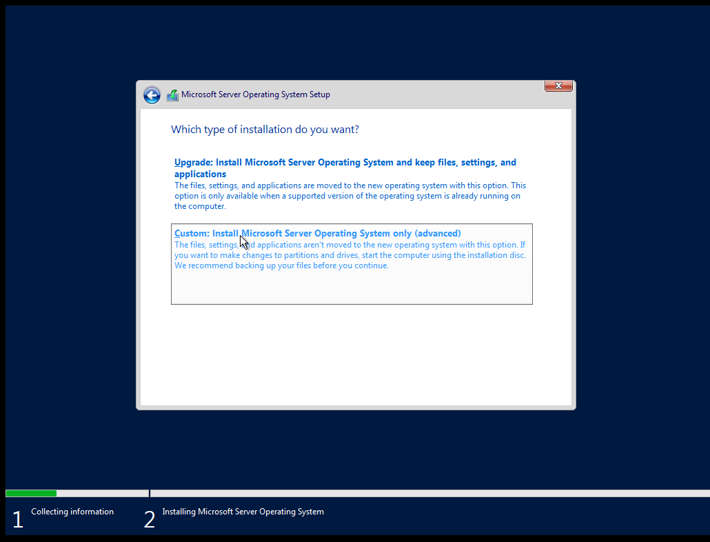


### Screenshot 06 — Select the unallocated virtual disk

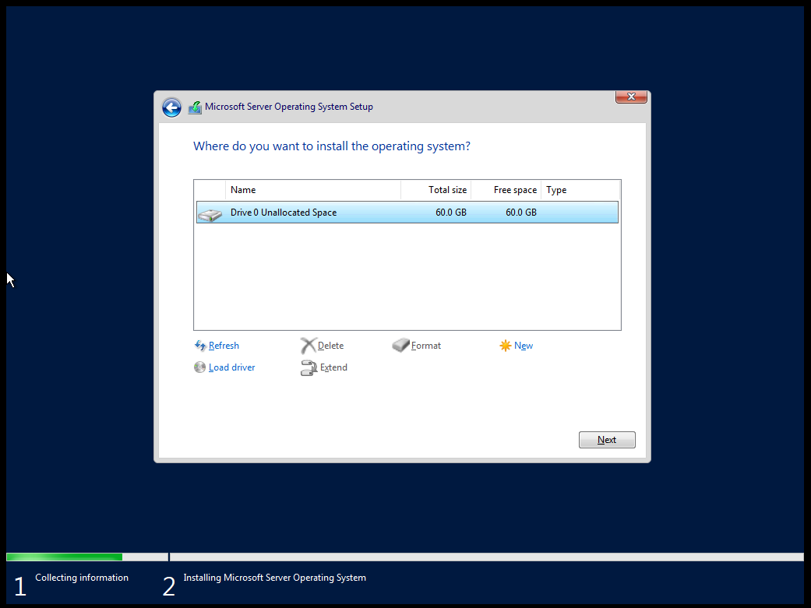

### 3.5 Complete installation

1. Wait while Windows Setup copies files, installs features and completes the operating system installation.
2. Allow the virtual machine to restart when prompted.
3. Do not power off the VM while installation is in progress.


### Screenshot 07 — Windows Server installation progress

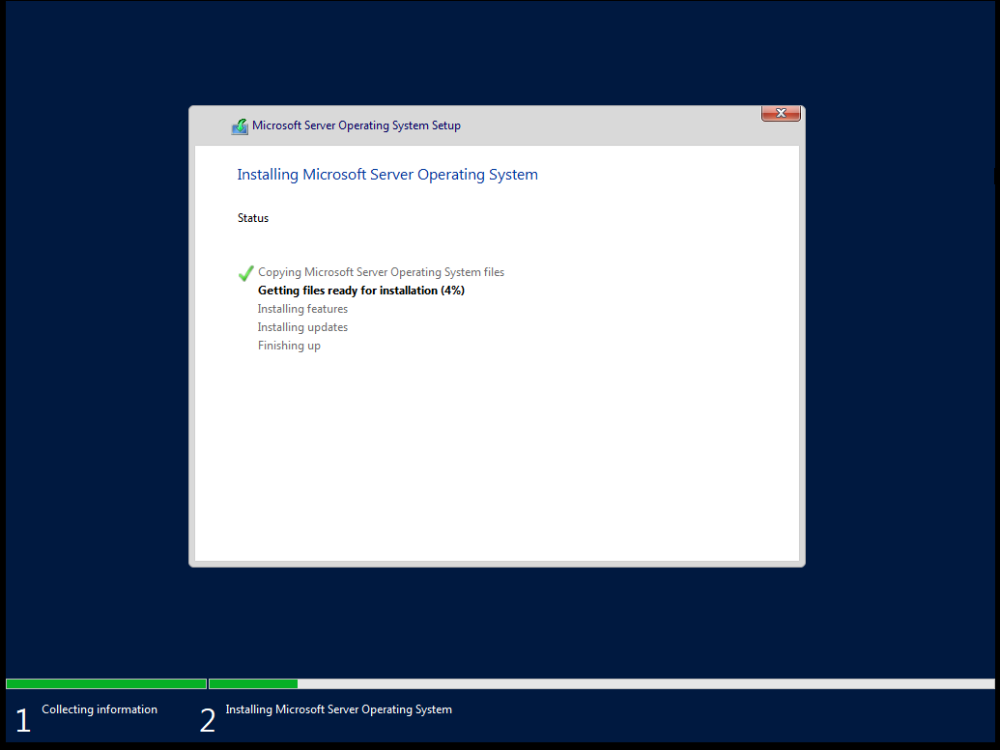

### 3.6 Set the local Administrator password and sign in

1. On the **Customize settings** screen, set a password for the built-in `Administrator` account.
2. Re-enter the password to confirm it.
3. Click **Finish**.
4. At the sign-in screen, sign in as `Administrator` using the password you created.


### Screenshot 08 — Set the built-in Administrator password

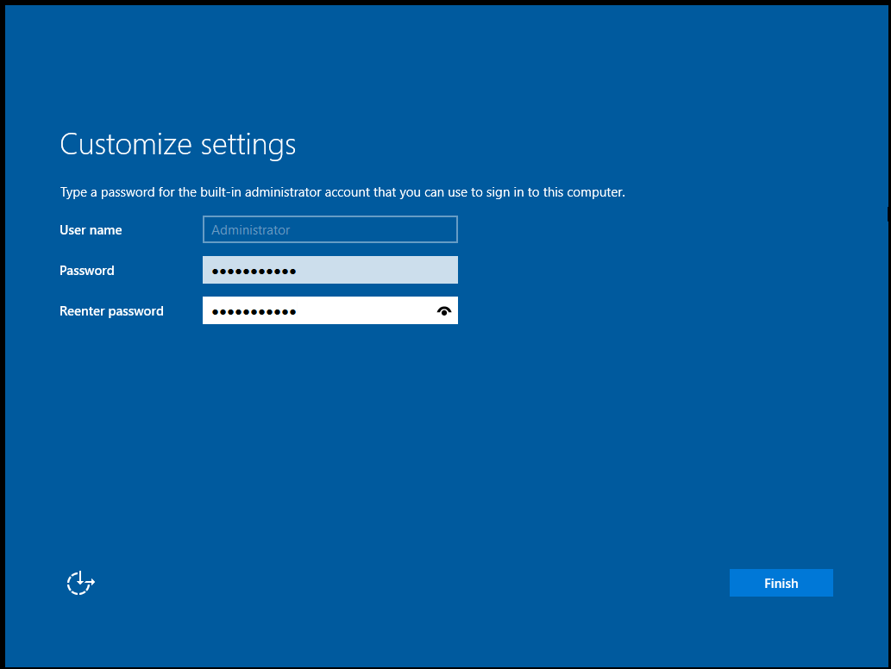


### Screenshot 09 — Sign in to the newly installed server

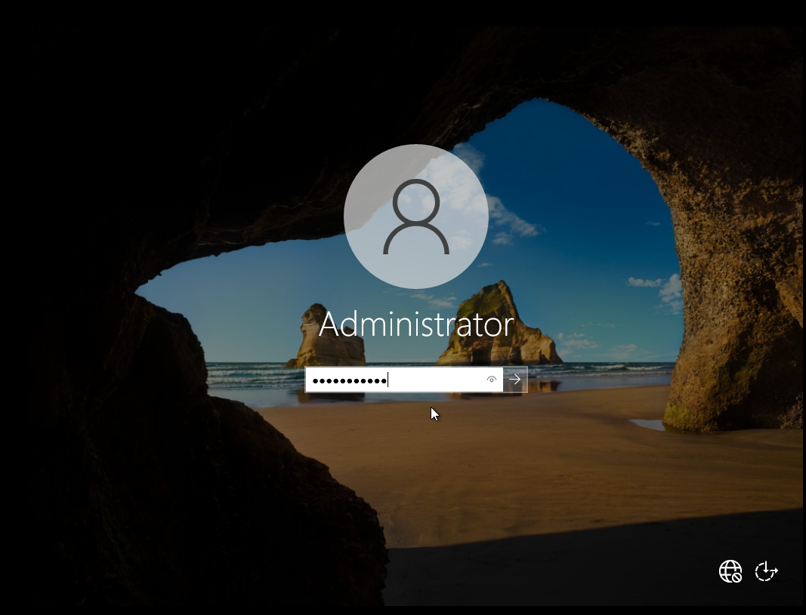

### 3.7 Confirm Server Manager

1. Wait for the Windows desktop to load.
2. Open **Server Manager** if it does not start automatically.
3. Confirm that the Server Manager Dashboard is displayed.


### Screenshot 10 — Server Manager dashboard after installation

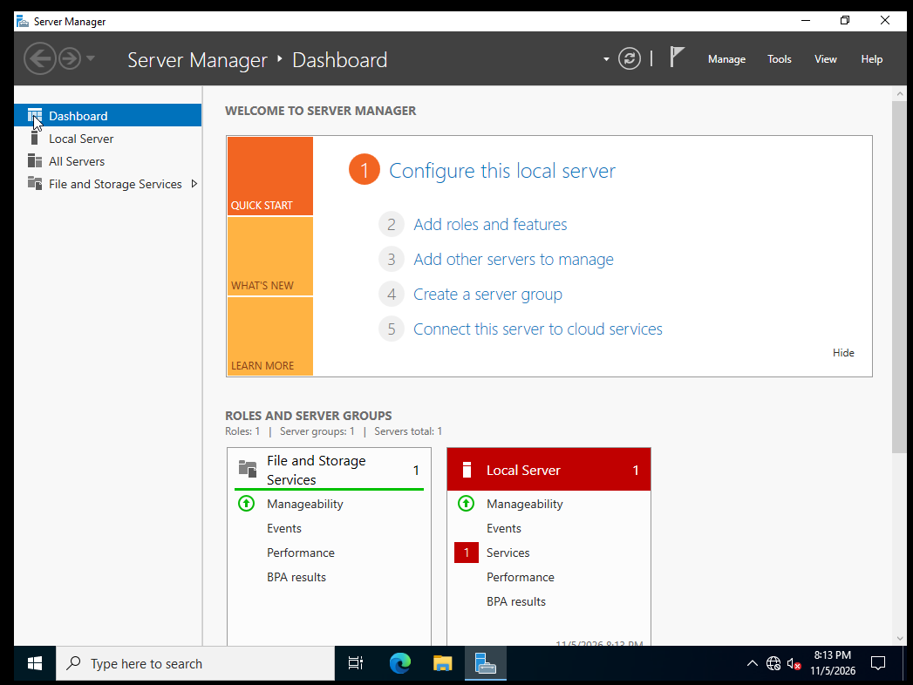

---

## 4. Rename the server to VD-DC01

1. In Server Manager, select **Local Server**.
2. In the Properties section, click the current computer name.
3. In System Properties, click **Change**.
4. Enter `VD-DC01` in the **Computer name** field.
5. Keep **Workgroup** selected at this stage; the server will be promoted to a domain controller later.
6. Click **OK** and accept the restart prompt if shown.
7. After the restart, sign in again as the local Administrator.


### Screenshot 11 — Change the computer name to VD-DC01

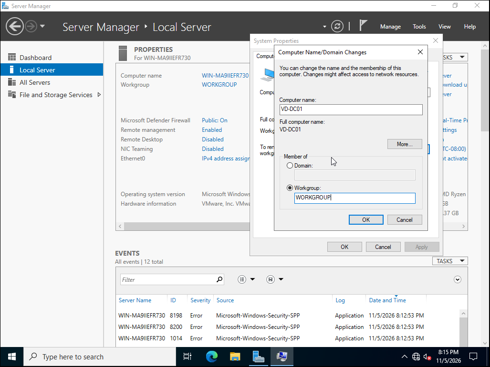

---

## 5. Configure static IPv4 networking

### 5.1 Open the network adapter settings

1. Sign in to `VD-DC01`.
2. Press `Win + R` to open the Run dialog.
3. Enter `ncpa.cpl` and press Enter.
4. In Network Connections, right-click the active Ethernet adapter and select **Properties**.
5. Select **Internet Protocol Version 4 (TCP/IPv4)** and click **Properties**.


### Screenshot 12 — Open Network Connections using ncpa.cpl

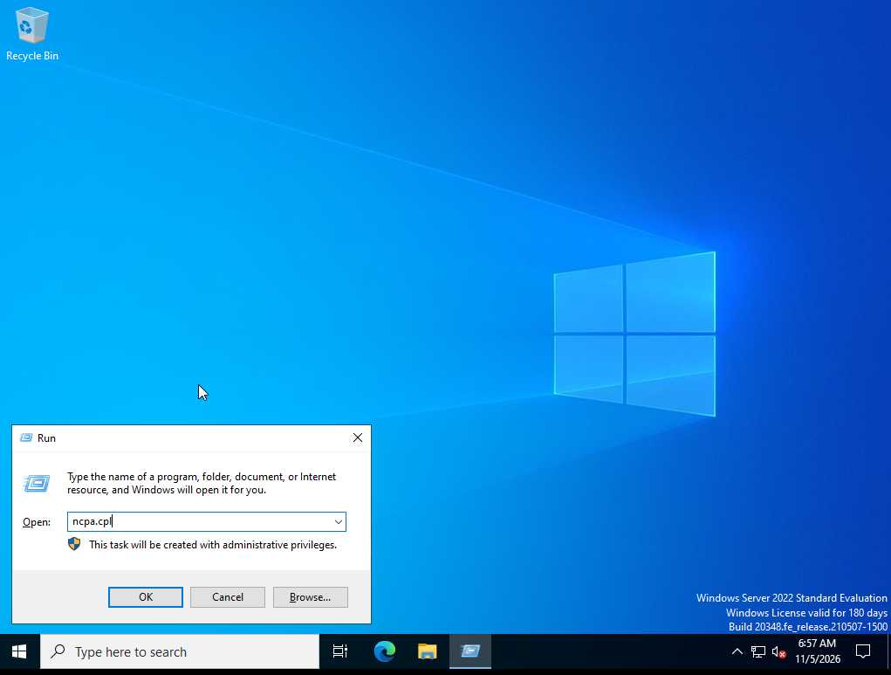

### 5.2 Enter the static IPv4 configuration

1. Select **Use the following IP address**.
2. Enter:
   - IP address: `192.168.176.10`
   - Subnet mask: `255.255.255.0`
   - Default gateway: `192.168.176.2`
3. Select **Use the following DNS server addresses**.
4. Set preferred DNS to `192.168.176.10`.
5. Leave **Alternate DNS server** blank in the final lab configuration.
6. Click **OK**, then close the adapter properties.

> The original screenshot displays `8.8.8.8` in the Alternate DNS field. That image is retained as original evidence. The final lab configuration uses preferred DNS `192.168.176.10` and leaves alternate DNS blank. The external resolver `8.8.8.8` is configured later as a DNS forwarder in DNS Manager.


### Screenshot 13 — Enter the server's static IPv4 and DNS settings

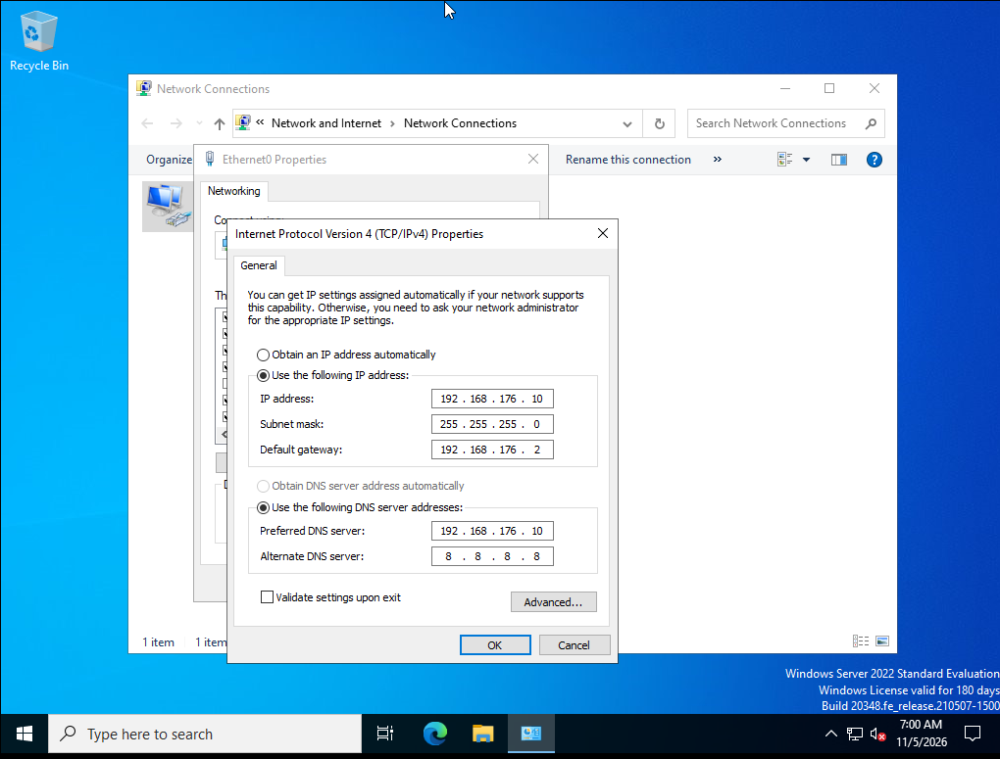

### 5.3 Verify the IP configuration

1. Open Command Prompt as Administrator.
2. Run:

```cmd
ipconfig /all
```

3. Check the hostname, IPv4 address, subnet mask, default gateway and DNS server entries.
4. Compare the displayed values with the lab configuration table.


### Screenshot 14 — Verify server network settings using ipconfig /all

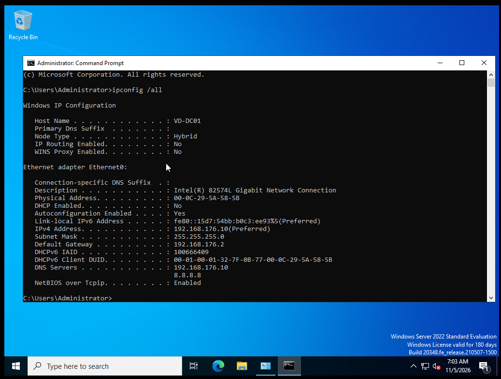

### 5.4 Test network connectivity

1. In the elevated Command Prompt, test the VMware NAT gateway:

```cmd
ping 192.168.176.2
```

2. Test external IP connectivity:

```cmd
ping 8.8.8.8
```

3. Confirm that replies are received and review the packet-loss summary.


### Screenshot 15 — Ping the NAT gateway and external IP address

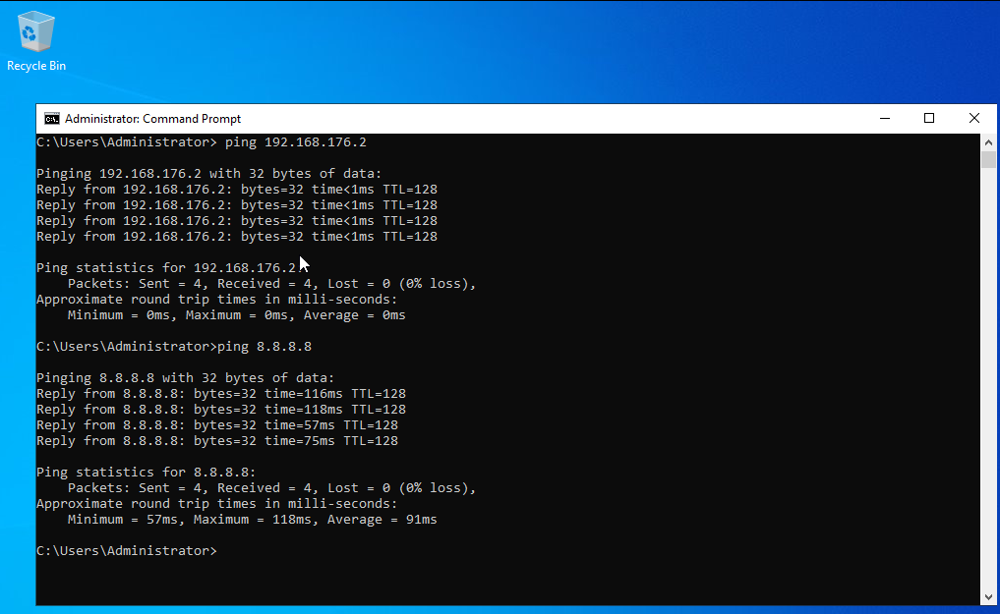

---

## 6. Install AD DS and DNS Server roles

### 6.1 Launch Add Roles and Features

1. Open **Server Manager**.
2. Select **Manage → Add Roles and Features**.
3. On **Before You Begin**, review the information and click **Next**.


### Screenshot 16 — Open Add Roles and Features from Server Manager

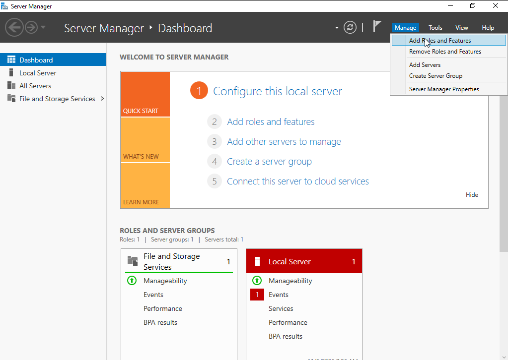


### Screenshot 17 — Add Roles and Features Wizard — Before You Begin

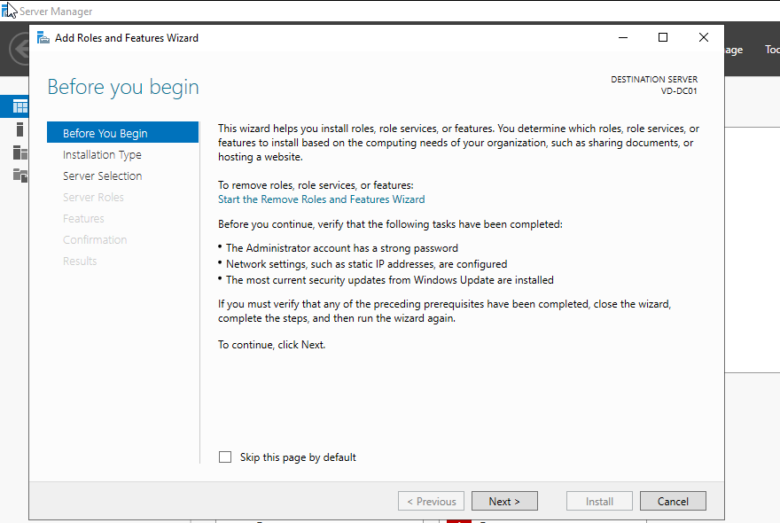

### 6.2 Select installation type and destination server

1. On **Installation Type**, select **Role-based or feature-based installation**.
2. Click **Next**.
3. On **Server Selection**, select **Select a server from the server pool**.
4. Select `VD-DC01`.
5. Click **Next**.


### Screenshot 18 — Select role-based or feature-based installation

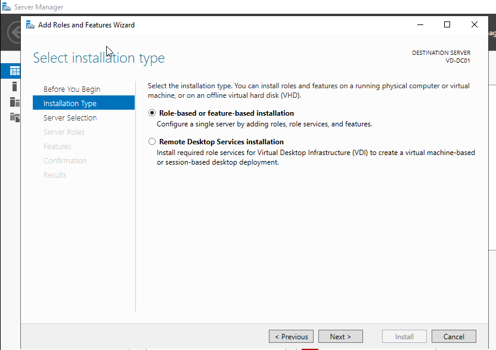


### Screenshot 19 — Select VD-DC01 as the destination server

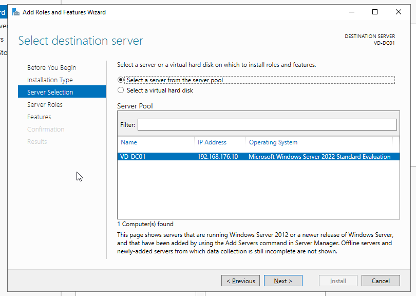

### 6.3 Select AD DS and DNS Server

1. On **Server Roles**, select **Active Directory Domain Services**.
2. When prompted, click **Add Features** to include the required management tools.
3. Select **DNS Server**.
4. Add the required DNS management features if prompted.
5. Click **Next**.


### Screenshot 20 — Select Active Directory Domain Services and DNS Server

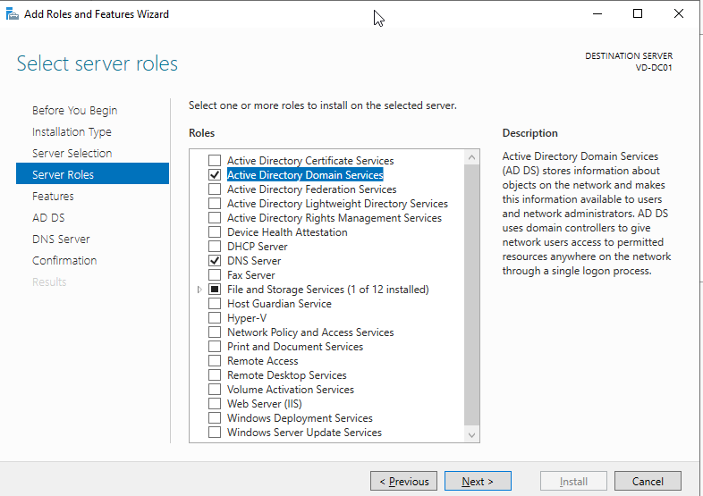

### 6.4 Review features and role information

1. Review the **Features** page and click **Next**.
2. Review the **Active Directory Domain Services** information page and click **Next**.
3. Review the **DNS Server** information page and click **Next**.


### Screenshot 21 — Review the Features page

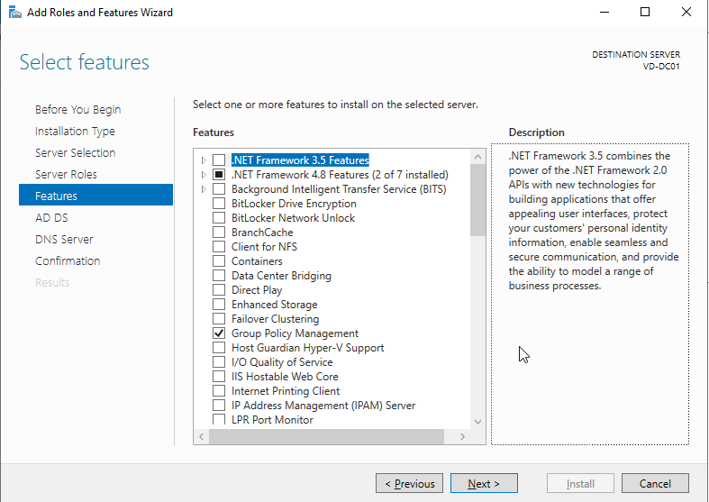


### Screenshot 22 — Review Active Directory Domain Services information

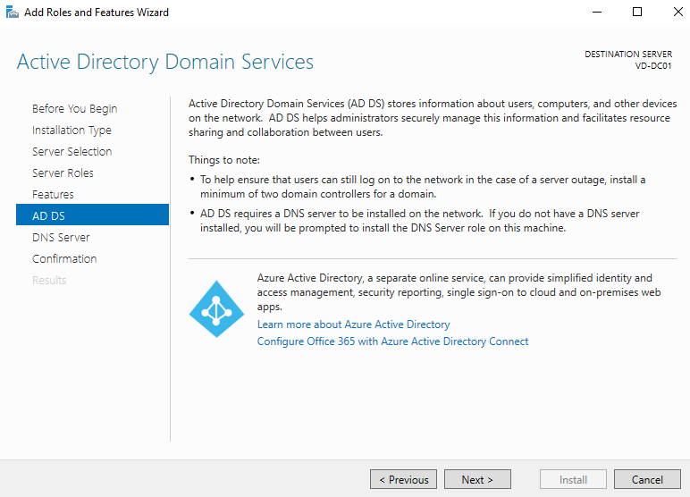


### Screenshot 23 — Review DNS Server information

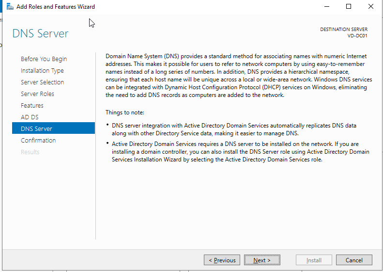

### 6.5 Confirm and install the roles

1. On **Confirmation**, review the selected roles and features.
2. Confirm that Active Directory Domain Services and DNS Server are included.
3. Click **Install**.
4. Wait for installation to finish and confirm successful installation.
5. Close the wizard when complete.

Installing the roles does not yet create the Active Directory domain. The server must be promoted in the next section.


### Screenshot 24 — Confirm the selected roles and features

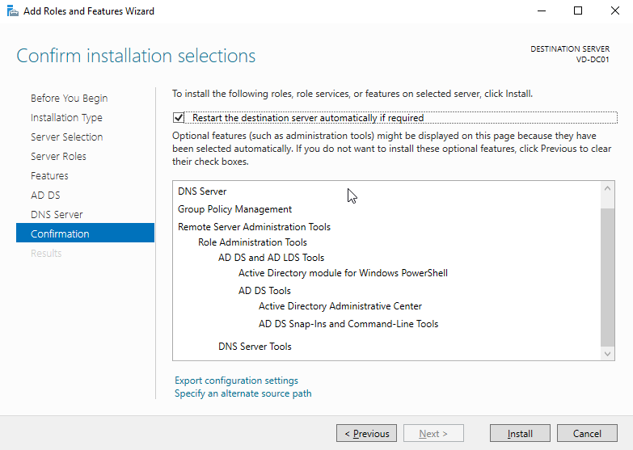


### Screenshot 25 — Role installation progress and successful installation

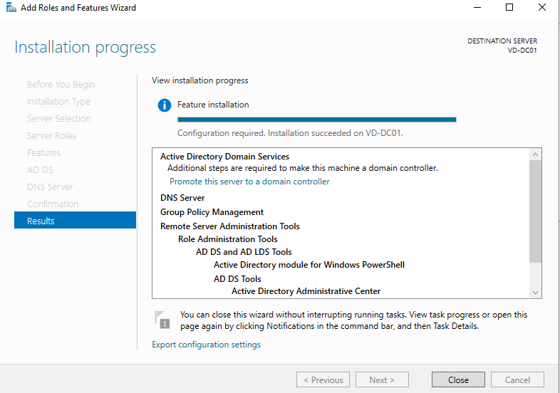

---

## 7. Promote VD-DC01 to a domain controller

### 7.1 Start the AD DS Configuration Wizard

1. In Server Manager, select the notification flag.
2. Click **Promote this server to a domain controller**.
3. In **Deployment Configuration**, select **Add a new forest**.
4. Enter the root domain name `vortexdynamics.test`.
5. Click **Next**.


### Screenshot 26 — Deployment Configuration — create a new forest named vortexdynamics.test

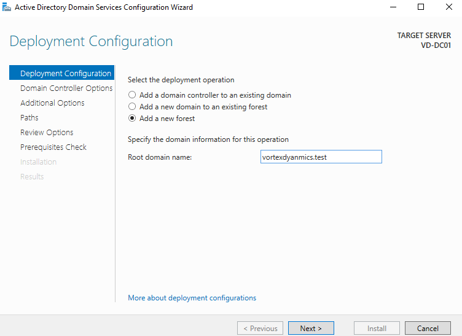

### 7.2 Configure Domain Controller Options

1. Review the forest and domain functional levels. The source screenshot shows **Windows Server 2016** for both.
2. Keep **Domain Name System (DNS) server** selected.
3. Keep **Global Catalog (GC)** selected.
4. Leave **Read only domain controller (RODC)** unchecked.
5. Enter and confirm a Directory Services Restore Mode (DSRM) password.
6. Store the DSRM password securely. It is separate from the normal domain Administrator password.
7. Click **Next**.


### Screenshot 27 — Configure domain controller capabilities and DSRM password

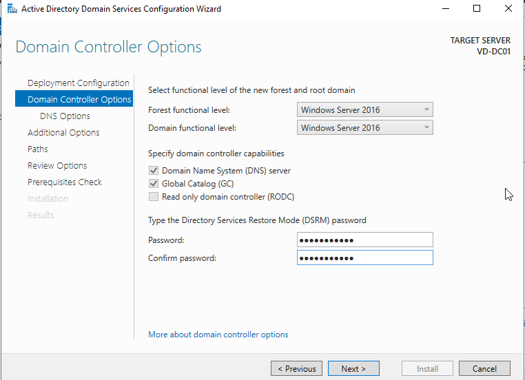

### 7.3 Review DNS delegation options

1. On **DNS Options**, review the delegation warning.
2. For this new standalone lab forest, leave **Create DNS delegation** unchecked.
3. Click **Next**.


### Screenshot 28 — DNS Options — leave Create DNS delegation unchecked

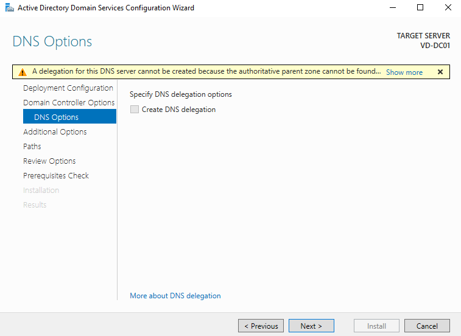

### 7.4 Confirm the NetBIOS domain name

1. On **Additional Options**, review the automatically generated NetBIOS name.
2. Confirm it is `VORTEXDYNAMICS`.
3. Click **Next**.


### Screenshot 29 — Additional Options — verify NetBIOS name VORTEXDYNAMICS

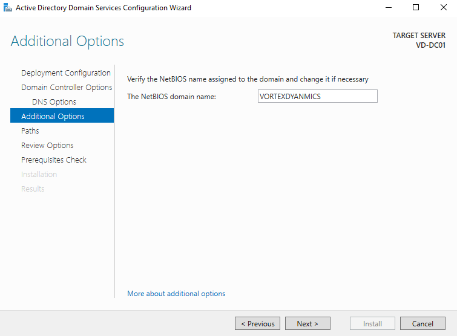

### 7.5 Review database, log and SYSVOL paths

1. Review the paths displayed by the wizard.
2. The screenshot shows these default locations:
   - Database folder: `C:\Windows\NTDS`
   - Log files folder: `C:\Windows\NTDS`
   - SYSVOL folder: `C:\Windows\SYSVOL`
3. Keep the default paths for this lab.
4. Click **Next**.


### Screenshot 30 — Review AD DS database, log and SYSVOL paths

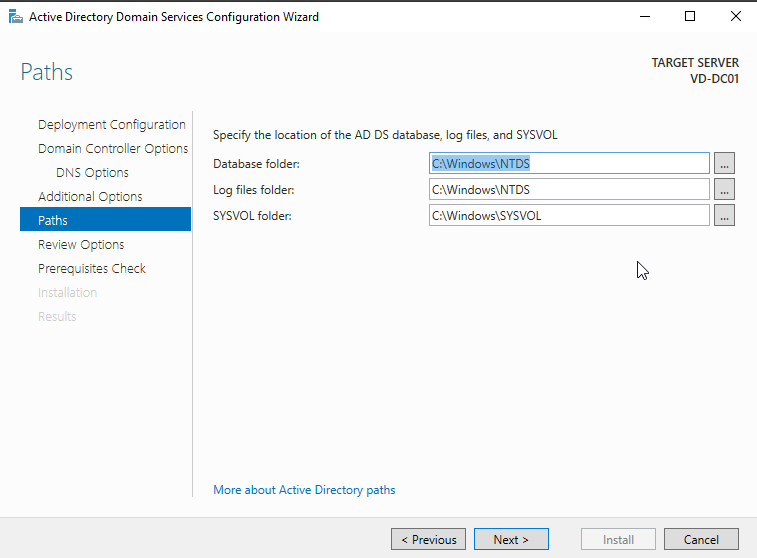

### 7.6 Review the configuration

1. Review the promotion summary.
2. Confirm that the new forest and domain are `vortexdynamics.test`.
3. Confirm the NetBIOS name is `VORTEXDYNAMICS`.
4. Confirm DNS Server and Global Catalog are selected.
5. Click **Next** to run prerequisite checks.


### Screenshot 31 — Review domain controller promotion options

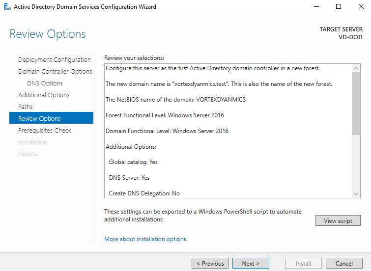

### 7.7 Run prerequisite checks and install

1. Wait for the prerequisite check to complete.
2. Review the results. The source screenshot reports that all prerequisite checks passed and displays informational warnings.
3. If the checks pass, click **Install**.
4. Wait for domain controller promotion to finish.
5. The server restarts automatically after promotion.


### Screenshot 32 — Prerequisite checks passed

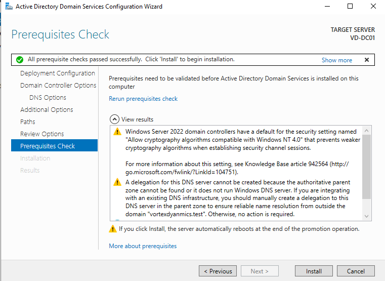


### Screenshot 33 — Domain controller promotion installation

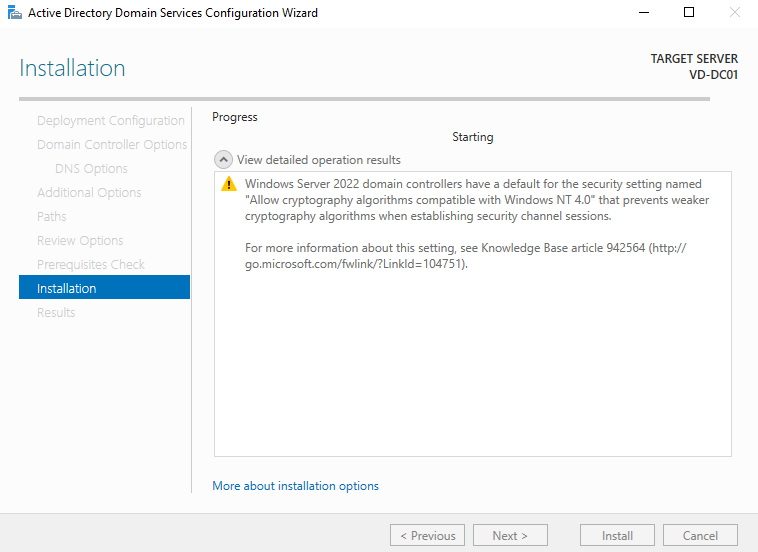

---

## 8. Sign in to the domain and verify the domain controller

### 8.1 Sign in after promotion

1. After the server restarts, select the `VORTEXDYNAMICS` domain account at the sign-in screen.
2. Sign in as the domain Administrator.
3. Wait for the desktop to load.


### Screenshot 34 — Domain sign-in screen after promotion

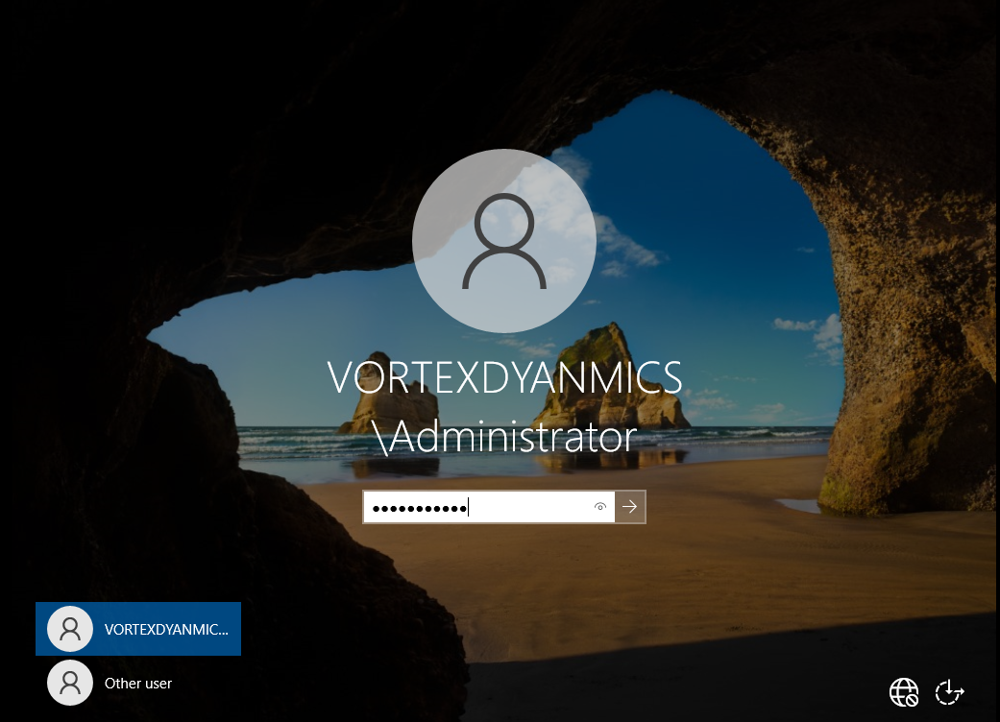

### 8.2 Verify the domain controller with PowerShell

1. Open **Windows PowerShell** as Administrator.
2. Run:

```powershell
Get-ADDomainController
```

3. Review the output and confirm:
   - Host name: `VD-DC01`
   - Domain: `vortexdynamics.test`
   - IPv4 address: `192.168.176.10`
   - Global Catalog: `True`


### Screenshot 35 — Verify VD-DC01 using Get-ADDomainController

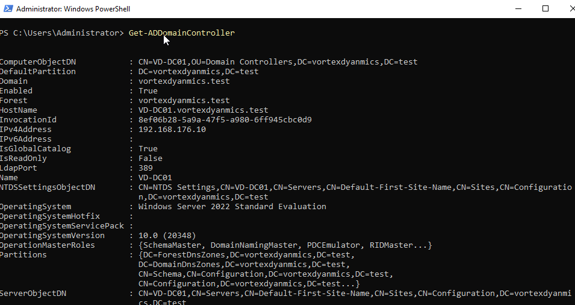

---

## 9. Verify AD DS and DNS services

### 9.1 Check Windows services

1. Open PowerShell as Administrator.
2. Run:

```powershell
Get-Service NTDS,DNS,Netlogon
```

3. Confirm that the services show the `Running` status:
   - `NTDS` — Active Directory Domain Services
   - `DNS` — DNS Server
   - `Netlogon` — Netlogon


### Screenshot 36 — Verify NTDS, DNS and Netlogon services are running

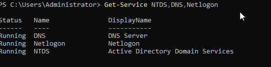

### 9.2 Verify domain controller shares

1. In PowerShell or Command Prompt, run:

```cmd
net share
```

2. Review the shared resources.
3. Confirm that `SYSVOL` and `NETLOGON` are present. These shares are used by domain logon and Group Policy.


### Screenshot 37 — Verify SYSVOL and NETLOGON shares using net share

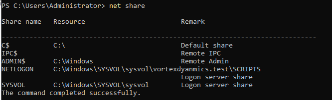

---

## 10. Configure and verify DNS

### 10.1 Open DNS Manager

1. Open **Server Manager**.
2. Select **Tools → DNS**.
3. In DNS Manager, expand `VD-DC01`.
4. Expand **Forward Lookup Zones**.
5. Select `vortexdynamics.test`.
6. Review the DNS records created for the domain.


### Screenshot 38 — Open DNS Manager from Server Manager Tools

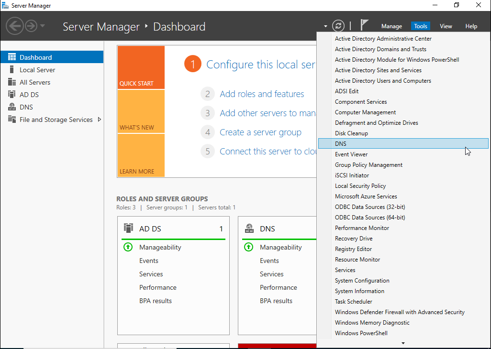


### Screenshot 39 — Inspect the vortexdynamics.test Forward Lookup Zone

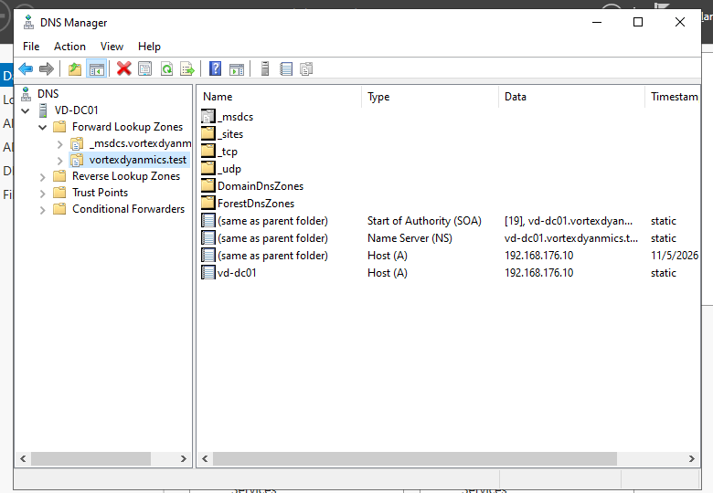

### 10.2 Configure a DNS forwarder

1. In DNS Manager, right-click `VD-DC01`.
2. Select **Properties**.
3. Open the **Forwarders** tab.
4. Click **Edit**.
5. Add the forwarder address `8.8.8.8`.
6. Confirm the address.
7. Keep **Use root hints if no forwarders are available** selected, as shown in the screenshot.
8. Click **Apply**, then **OK**.

The forwarder is configured on the DNS server. It is not entered as the alternate DNS address on the server or client network adapter.


### Screenshot 40 — Configure 8.8.8.8 as the DNS forwarder

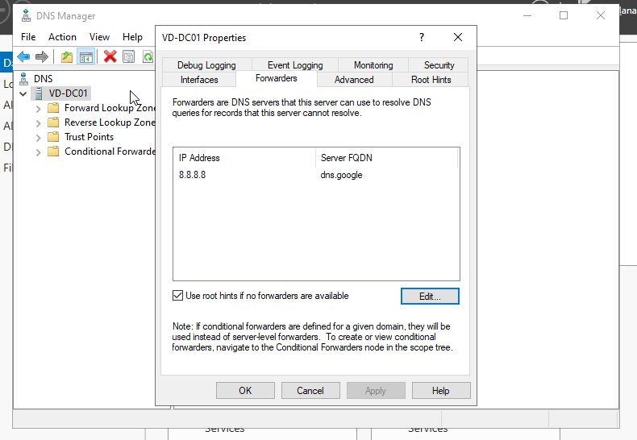

### 10.3 Verify server DNS client configuration

1. Open Command Prompt as Administrator.
2. Run:

```cmd
ipconfig /all
```

3. Confirm the server host name and DNS suffix.
4. Confirm the IPv4 address is `192.168.176.10`.
5. Confirm the DNS client is using the local DNS service.


### Screenshot 41 — Review server DNS configuration using ipconfig /all

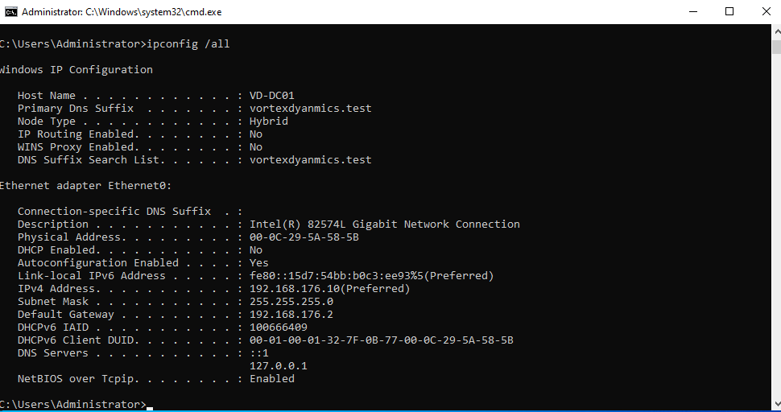

### 10.4 Test internal and external name resolution

Run:

```cmd
nslookup vortexdynamics.test
nslookup VD-DC01.vortexdynamics.test
nslookup microsoft.com
```

Check the results:

- `vortexdynamics.test` resolves to `192.168.176.10`.
- `VD-DC01.vortexdynamics.test` resolves to `192.168.176.10`.
- `microsoft.com` returns external DNS records through the configured forwarder.

The output may show the DNS server as `Unknown` with address `::1`. This can occur when a reverse lookup record for the DNS server address is not configured. Check the returned DNS answers to determine whether forward name resolution is working.


### Screenshot 42 — Verify internal domain and external DNS resolution with nslookup

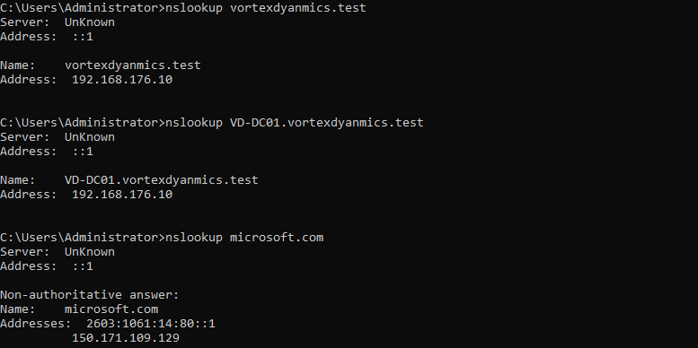

---
