# Phase 3 — Group Policy Management

**Project:** VortexDynamics – Enterprise Active Directory Infrastructure and IT Administration Lab  
**Domain:** `vortexdynamics.test`  
**Domain Controller:** `VD-DC01`  
**Client:** `VD-CLIENT01`

---

## 1. Phase objective

This phase documents the Group Policy tasks completed in the VortexDynamics Active Directory lab:

1. Open Group Policy Management and inspect the Default Domain Policy.
2. Configure the domain password policy.
3. Create and configure `GPO-USB-Restriction` to deny removable-disk read, write and execute access.
4. Link the USB restriction GPO to `VortexDynamics Computers\IT Computers`.
5. Create and link the Control Panel restriction GPO to `VortexDynamics Users`.
6. Refresh Group Policy and verify that the Control Panel restriction is applied to a domain user.

## 2. Environment and target OUs

| Item | Configuration |
|---|---|
| Active Directory domain | `vortexdynamics.test` |
| NetBIOS domain | `VORTEXDYNAMICS` |
| Domain Controller | `VD-DC01` |
| Domain client | `VD-CLIENT01` |
| Computer policy target | `VortexDynamics Computers\IT Computers` |
| User policy target | `VortexDynamics Users` |

## 3. Open Group Policy Management

1. Sign in to `VD-DC01` using a domain administrative account.
2. Open **Server Manager**.
3. Select **Tools → Group Policy Management**.
4. Expand **Forest: vortexdynamics.test**.
5. Expand **Domains → vortexdynamics.test**.
6. Review the domain, the existing Default Domain Policy and the organizational units.
7. Use **Group Policy Objects** to view GPO objects, and select an OU to inspect the GPOs linked to that OU.


### Screenshot 01 — Open Group Policy Management from Server Manager → Tools

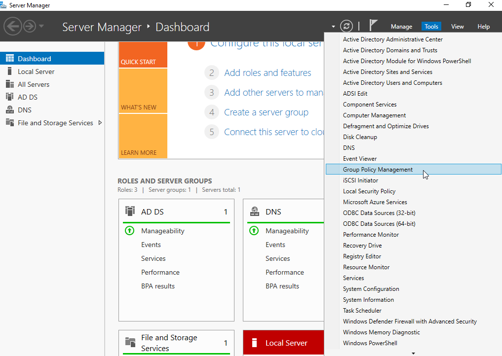


### Screenshot 02 — Default Domain Policy selected in Group Policy Management

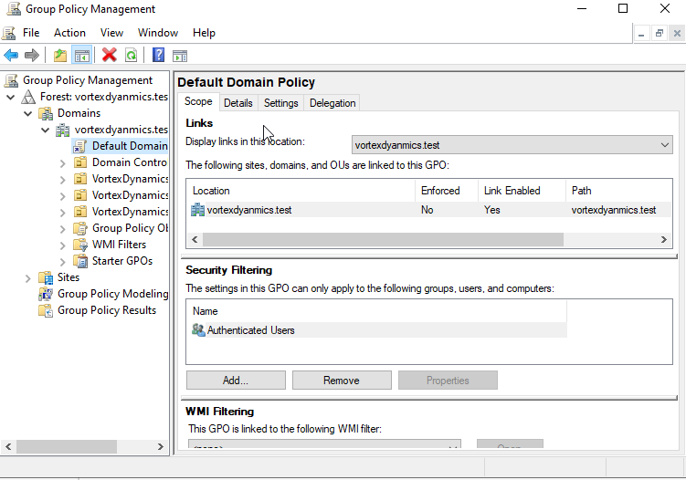

> The screenshot shows the Default Domain Policy linked at the domain root, with Authenticated Users in Security Filtering.

## 4. Configure the Default Domain Policy — Password Policy

The password policy was configured by editing the existing **Default Domain Policy**.

### 4.1 Open the policy editor

1. In Group Policy Management, expand `vortexdynamics.test`.
2. Right-click **Default Domain Policy**.
3. Select **Edit**.
4. In Group Policy Management Editor, navigate to:

   `Computer Configuration → Policies → Windows Settings → Security Settings → Account Policies → Password Policy`

5. Select **Password Policy** to display the available settings.


### Screenshot 03 — Password Policy before the changes

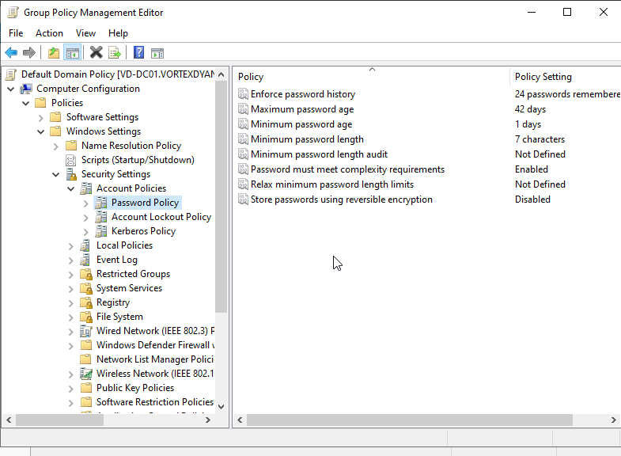

> The original values visible in the screenshot include 24 passwords remembered, maximum password age 42 days, minimum password age 1 day and minimum password length 7 characters.


### 4.2 Set the password policy values

Configure the following values:

| Password policy setting | Final value |
|---|---:|
| Enforce password history | 5 passwords remembered |
| Maximum password age | 90 days |
| Minimum password age | 1 day |
| Minimum password length | 10 characters |
| Password must meet complexity requirements | Enabled |
| Store passwords using reversible encryption | Disabled |

For each setting:

1. Double-click the policy.
2. Select **Define this policy setting** if that option is displayed.
3. Enter the required number or select **Enabled** or **Disabled**.
4. Click **Apply**, then **OK**.
5. Repeat for the remaining settings.
6. Return to the Password Policy list and verify the displayed values.


### Screenshot 04 — Password Policy after the changes

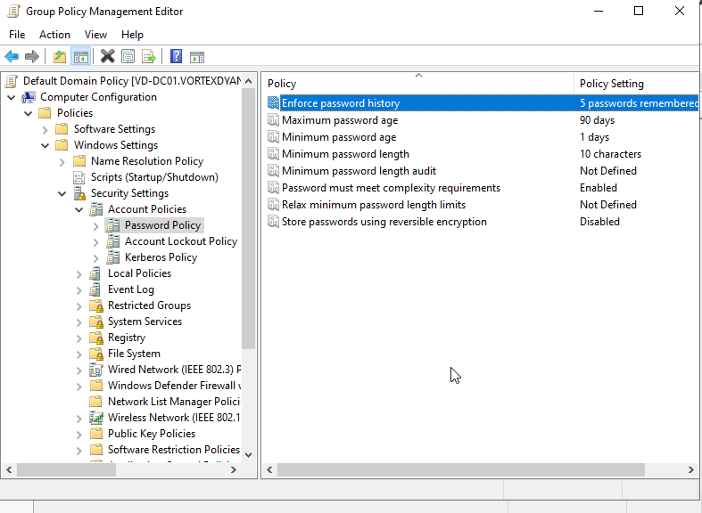

> The screenshot confirms the final values: history 5, maximum age 90 days, minimum age 1 day, minimum length 10 characters, complexity enabled and reversible encryption disabled.


## 5. Create `GPO-USB-Restriction`

This GPO controls read, write and execute access to removable disks. It is intended for computers placed in the IT Computers OU.

### 5.1 Create the GPO object

1. In Group Policy Management, expand the `vortexdynamics.test` domain.
2. Right-click the domain.
3. Select **Create a GPO in this domain, and Link it here**.
4. In the **New GPO** dialog, enter:

   `GPO-USB-Restriction`

5. Leave **Source Starter GPO** set to `(none)`.
6. Click **OK**.


### Screenshot 05 — Open the domain context menu to create a new GPO

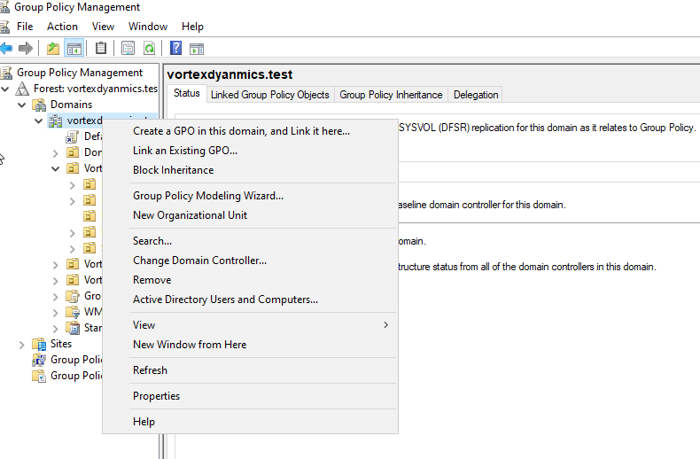


### Screenshot 06 — Enter the GPO name GPO-USB-Restriction

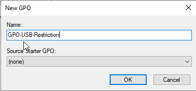

> The New GPO dialog in the screenshot shows the exact GPO name and Source Starter GPO set to none.


### 5.2 Open the GPO editor

1. Locate `GPO-USB-Restriction` in the Group Policy Management tree.
2. Right-click the GPO.
3. Select **Edit**.
4. In Group Policy Management Editor, navigate to:

   `Computer Configuration → Policies → Administrative Templates → System → Removable Storage Access`

5. In the right pane, locate the three **Removable Disks** settings.


### Screenshot 07 — Open the GPO context menu and navigate to Removable Storage Access

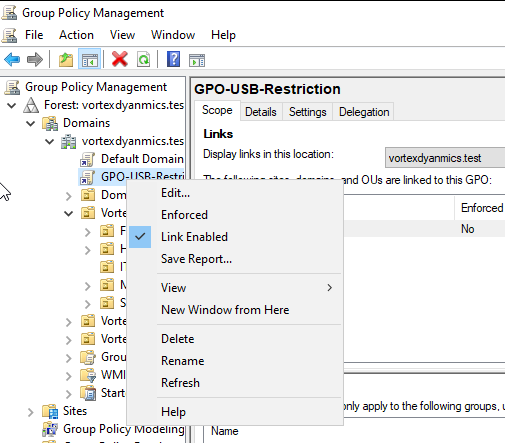


### Screenshot 08 — Select the Removable Disks: Deny execute access setting

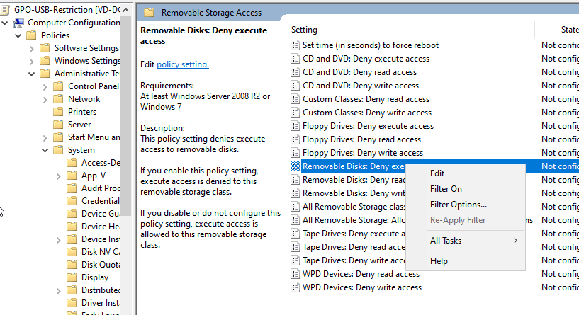


### 5.3 Enable the three removable-disk restrictions

Configure each setting individually:

**A. Deny execute access**

1. Double-click **Removable Disks: Deny execute access**.
2. Select **Enabled**.
3. Click **Apply**, then **OK**.


### Screenshot 09 — Enable Removable Disks: Deny execute access

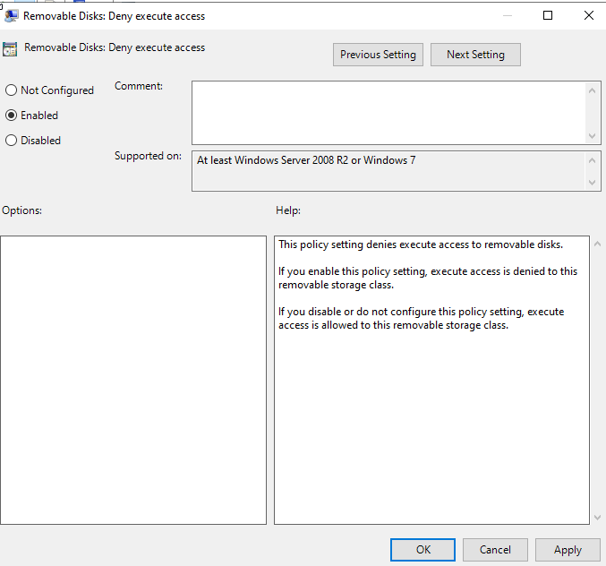


**B. Deny read access**

1. Return to the Removable Storage Access policy list.
2. Double-click **Removable Disks: Deny read access**.
3. Select **Enabled**.
4. Click **Apply**, then **OK**.

**C. Deny write access**

1. Return to the Removable Storage Access policy list.
2. Double-click **Removable Disks: Deny write access**.
3. Select **Enabled**.
4. Click **Apply**, then **OK**.

5. Return to the policy list and verify that all three settings show **Enabled**.


### Screenshot 10 — Verify all three removable-disk restrictions are enabled

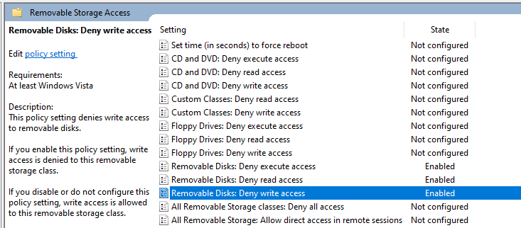

> The policy list in this screenshot shows Deny execute access, Deny read access and Deny write access as Enabled.


## 6. Link `GPO-USB-Restriction` to the IT Computers OU

The GPO is linked to the IT Computers OU so the computer policy applies to computers located in that OU.

1. In Group Policy Management, expand:

   `VortexDynamics Computers`

2. Right-click **IT Computers**.
3. Select **Link an Existing GPO**.
4. In the **Select GPO** dialog, select `GPO-USB-Restriction`.
5. Click **OK**.
6. Select **IT Computers** and open the **Linked Group Policy Objects** tab.
7. Verify that `GPO-USB-Restriction` appears in the linked GPO list and that **Link Enabled** is set to **Yes**.


### Screenshot 11 — Open Link an Existing GPO from the IT Computers OU

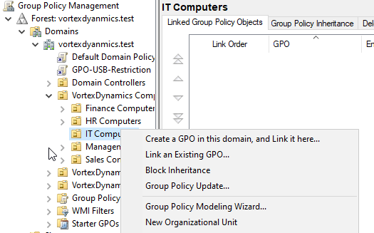


### Screenshot 12 — Select GPO-USB-Restriction in the Select GPO dialog

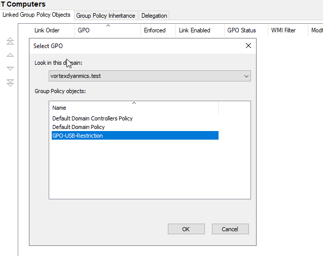


### Screenshot 13 — Verify GPO-USB-Restriction is linked under IT Computers

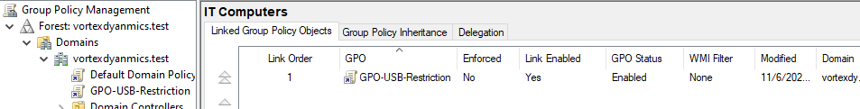

> The screenshot shows GPO-USB-Restriction in the IT Computers linked GPO list, with the link enabled.

## 7. Create and link the Control Panel restriction GPO

The Control Panel restriction is a **user configuration** policy. It is linked to the `VortexDynamics Users` OU.

### 7.1 Create the GPO

1. In Group Policy Management, locate the `VortexDynamics Users` OU.
2. Right-click the OU.
3. Select **Create a GPO in this domain, and Link it here**.
4. Enter the GPO name:

   `GPO-ControlPanel-Restricted`

5. Click **OK**.

If the GPO already exists, use **Link an Existing GPO** rather than creating a duplicate.

### 7.2 Configure the Control Panel restriction

1. Locate `GPO-ControlPanel-Restricted`.
2. Right-click it and select **Edit**.
3. Navigate to:

   `User Configuration → Policies → Administrative Templates → Control Panel`

4. Open **Prohibit access to Control Panel and PC settings**.
5. Select **Enabled**.
6. Click **Apply**, then **OK**.
7. Close Group Policy Management Editor.

### 7.3 Verify the OU link

1. Select the `VortexDynamics Users` OU in Group Policy Management.
2. Open **Linked Group Policy Objects**.
3. Confirm `GPO-ControlPanel-Restricted` appears in the list.
4. Confirm **Link Enabled** is **Yes**.


### Screenshot 14 — Verify the Control Panel restriction GPO is linked to VortexDynamics Users

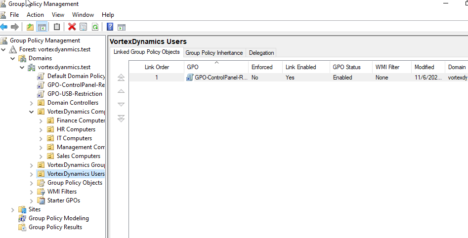

> The source screenshot shows the Control Panel GPO linked under VortexDynamics Users with the link enabled.


## 8. Refresh Group Policy and test the Control Panel restriction

1. Sign in to `VD-CLIENT01` using a domain user account located in `VortexDynamics Users`, such as `rahul.sharma`.
2. Open Command Prompt.
3. Run:

```cmd
gpupdate /force
```

4. Wait for the computer and user policy refresh to complete.
5. Try to open Control Panel.
6. Verify that Windows displays the restriction message and prevents access.


### Screenshot 15 — Control Panel restriction applied to the domain user

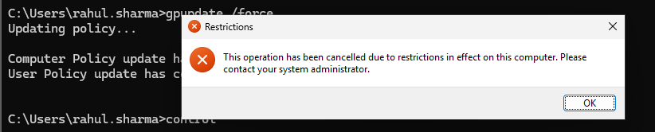

> The screenshot shows the restriction message: the operation was cancelled due to restrictions in effect on the computer.

## 9. Verification commands

Use these commands on the domain client to refresh and inspect policy application.

Force a policy refresh:

```cmd
gpupdate /force
```

Display the applied policies:

```cmd
gpresult /r
```

Generate a detailed HTML report on the desktop:

```cmd
gpresult /h "%USERPROFILE%\Desktop\GPResult.html"
```

Review the report to confirm which policies were applied to the computer and the signed-in user. For the USB restriction, check the computer policy scope. For the Control Panel restriction, check the user policy scope.

## 10. Completed work summary

| Task | Completed configuration |
|---|---|
| Group Policy Management | Opened and used on `VD-DC01` |
| Default Domain Policy | Password policy values updated |
| USB restriction GPO | `GPO-USB-Restriction` created |
| Removable disk execution | Deny execute access enabled |
| Removable disk reading | Deny read access enabled |
| Removable disk writing | Deny write access enabled |
| USB GPO scope | Linked to `VortexDynamics Computers\IT Computers` |
| Control Panel GPO | `GPO-ControlPanel-Restricted` created and configured |
| Control Panel GPO scope | Linked to `VortexDynamics Users` |
| Policy refresh | `gpupdate /force` run on the client |
| Control Panel test | Restriction message observed for the domain user |